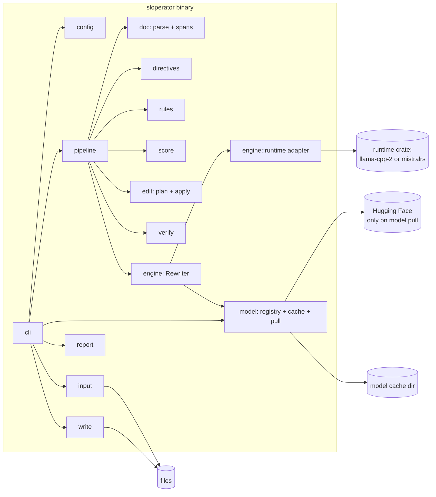
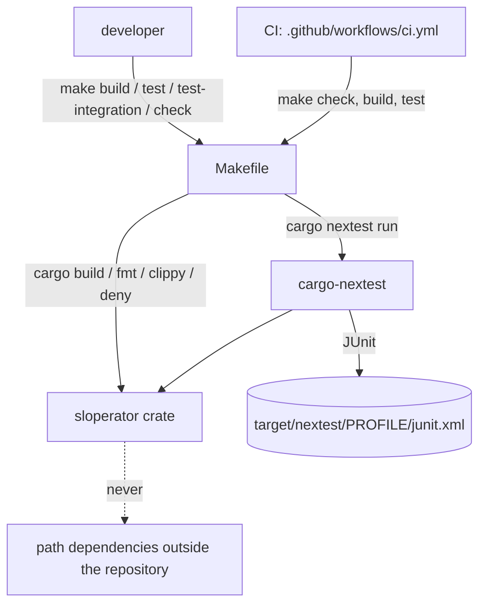
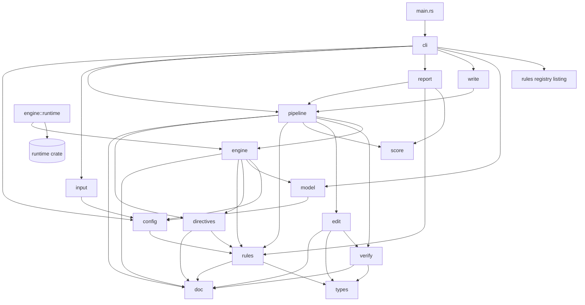
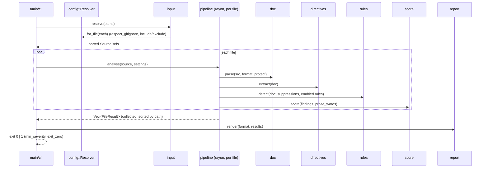

# Architecture: sloperator — a standalone CLI that makes LLM-generated text read as human

**Version:** 0.1
**Date:** 2026-10-29
**Status:** Draft
**Companion:** [PRD](./PRD.md) · no UX scope (CLI surface is specified in PRD FR-2/FR-3)
**Crate:** `sloperator` at the repository root (one Rust crate plus its `Makefile`)

---

## 1. Context and Quality Goals

sloperator is a Rust linter for Markdown and plain-text prose. It finds LLM style tells, scores them, and with
`--fix` rewrites them: first with deterministic safe fixes, then with a local small language model. Every edit
passes a verifier before it is written. The crate sits at the repository root and depends on no code
outside it. Its `Makefile` is the one entry point for developers and CI. It serves [PRD-sloperator](./PRD.md) (D-1 to
D-12, FR-1 to FR-10, NFR-1 to NFR-9).

| Quality goal | From | What it demands of the design |
|--------------|------|-------------------------------|
| Protected bytes never change | FR-8.1-8.4, D-7 | Edits are byte ranges over the original source, confined to prose spans; protected bytes are copied, never re-rendered (ADR-03). The model never sees protected text; it sees opaque placeholders (ADR-04). |
| No unverified edit is ever written | D-4, FR-8.5-8.7, FR-9.5 | One verifier sits between every engine and the edit applier. Both engines' edits go through it (ADR-05). |
| Lint is cheap and model-free | D-3, FR-2.1, NFR-3 | `check` without `--fix`/`--diff` never constructs the model engine. The unit tier compiles without the inference runtime (ADR-02). |
| Fail loudly | NFR-4 | One error type maps to exit 2. No code path converts a model error into a rules-only result. |
| Standalone | D-2, NFR-2, FR-1.8 | One crate with no path dependency outside the repository. A unit test enforces it. |
| One build entry point with per-test reports | D-11, FR-1.2-1.9 | The `Makefile` runs cargo and cargo-nextest; nextest profiles write JUnit XML to `target/nextest/<profile>/junit.xml`; `TESTS` becomes one nextest filterset (ADR-07). |
| Deterministic output | NFR-6, FR-3.6, FR-5.3 | Files may be analysed in parallel; results are sorted by path before any output (ADR-09). |
| Runtime replaceable | D-6 | One synchronous `Rewriter` trait. Exactly one adapter module touches the runtime crate (ADR-02). |

## 2. Build and CI Touchpoints

sloperator's code depends on nothing outside the repository. The touchpoints are the files that build, test and
check it; developers and CI use the same `make` targets.

| Touchpoint | Where | What is true | How this design uses it |
|------------|-------|--------------|-------------------------|
| Build entry point | `Makefile` | Targets `build`, `test`, `test-integration`, `check`, `clean`, `help` (default goal `help`). Recipes run under `bash` with `.ONESHELL` and `-eu -o pipefail`. | The one entry point for developers and CI (D-11, FR-1.2). Every recipe calls cargo, cargo-nextest or cargo-deny directly. |
| Test selection | `Makefile` (`TESTS`) | `make test TESTS='<selector> ...'` maps selector words to one nextest filterset; `TESTS` is read through `$(origin TESTS)`. | `binary_id#test` selects one test exactly; a bare word is a substring of the binary id or test name (FR-1.5, ADR-07). |
| Empty-run guard | `Makefile` (`count`) | After a run, the recipe counts `<testcase` elements in the reports. | A selector that matches no test fails the run instead of passing green (FR-1.5). |
| Test reports | `.config/nextest.toml` | Profiles `ci` (unit), `ci-perf` (NFR-3 benchmark, one thread) and `it` (integration, one thread, slow timeout) each write `target/nextest/<profile>/junit.xml`. | JUnit for CI and reviewers, with no copy or conversion step (FR-1.4, ADR-07). |
| Perf pass | `Makefile` (`test`) | The NFR-3 benchmark runs in the release profile with `--target-dir target/perf`, only when no selector is given or a selector names `perf`. | Keeps `make build`'s model-enabled `target/release/sloperator` intact and keeps targeted runs fast. |
| Missing tools | `Makefile` (`need`) | A missing `cargo`, `cargo-nextest` or `cargo-deny` prints a one-line banner with the install hint on stderr and exits 1. | Fail loudly, never skip (FR-1.9). |
| CI | `.github/workflows/ci.yml` | On macOS: installs the pinned toolchain, cargo-nextest, cargo-deny and cmake, then runs `make check`, `make build`, `make test`. | Same targets as a developer machine; integration tier is not run in CI (§11). |
| Toolchain | `rust-toolchain.toml` | Pins the Rust channel with `rustfmt` and `clippy`. | Reproducible builds and lints (NFR-7). |
| Ignore rules | `.gitignore` | `/target` (binaries, nextest reports, eval report). | Build output never enters git (FR-1.1). |
| Standalone scan | `tests/standalone.rs` | Scans every file for references to the development host and `Cargo.toml` for path dependencies. | FR-1.8, NFR-2 (§5). |

## 3. Overview



The shape is a **pipeline over an immutable source document**. `doc` parses Markdown once into a span map: prose
spans (editable) and protected spans (copied verbatim). `rules` and the model `engine` only ever *propose* edits
as byte ranges inside prose spans. `verify` accepts or rejects each proposal. `edit` applies the accepted ones to
the original bytes. Nothing re-renders Markdown, so every byte outside an accepted edit is the input byte
(ADR-03).

Two patterns carry the design. **Ports and adapters** for the model: the pipeline sees a synchronous `Rewriter`
trait, and one adapter module hides the runtime crate, its async API and its threads (ADR-02). **Propose/verify/
apply** for edits: engines cannot write, and the verifier cannot be skipped because `edit::apply` takes only
`Verified<Edit>` values, which only `verify` can construct (ADR-05).

## 4. Components

All components are Rust modules in one crate at the repository root, library `sloperator` (`src/lib.rs`) plus binary
`sloperator` (`src/main.rs`). ADR-01 explains why a single crate. Sketches are Rust; names are proposals for the SPEC.

### 4.1 cli

**Responsibility:** Parse arguments, merge flags over config, run one command, map the outcome to an exit code.
**Module / package root:** `src/cli` / `sloperator::cli` (+ `src/main.rs`)
**Serves:** FR-2.1-2.16, FR-3.5, D-3, D-8
**Interface (sketch):**

```rust
#[derive(clap::Parser)] pub struct Cli { #[command(subcommand)] pub cmd: Command }
pub enum Command { Check(CheckArgs), Rules(RulesArgs), Config(ConfigArgs), Model(ModelCmd) }
pub struct CheckArgs { pub paths: Vec<String>, pub fix: bool, pub diff: bool, pub rules_only: bool,
    pub model_only: bool, pub output_format: OutputFormat, pub min_severity: Option<Severity>,
    pub exit_zero: bool, pub select: Vec<RuleCode>, pub extend_select: Vec<RuleCode>, pub ignore: Vec<RuleCode>,
    pub config: Option<PathBuf>, pub stdin_filename: Option<PathBuf>, pub seed: Option<u64> }
pub enum ExitCode { Clean = 0, Findings = 1, Failure = 2 }
/// The only place the process exit code is decided. `deps` carries the injectable seams (ADR-02, §11).
pub fn run(cli: Cli, deps: &mut Deps, out: &mut dyn Write, err: &mut dyn Write) -> ExitCode;
pub struct Deps { pub rewriter_factory: Box<dyn RewriterFactory>, pub fs: Box<dyn Fs>, pub now_seed: u64 }
```

**Depends on:** config, input, pipeline, report, write, model, rules (registry listing) · **Must never depend on:**
`engine::runtime` directly, the runtime crate, the network.

### 4.2 config

**Responsibility:** Discover, parse, validate and resolve `sloperator.toml` per input file into an immutable
`Settings`.
**Module / package root:** `sloperator::config`
**Serves:** FR-7.1-7.6, FR-2.11, FR-2.13, D-8, D-9
**Interface (sketch):**

```rust
#[derive(serde::Deserialize)] #[serde(deny_unknown_fields)]
pub struct ConfigFile { pub extend: Option<PathBuf>, pub select: Option<Vec<RuleCode>>,
    pub extend_select: Option<Vec<RuleCode>>, pub ignore: Option<Vec<RuleCode>>, pub min_severity: Option<Severity>,
    pub include: Option<Vec<String>>, pub exclude: Option<Vec<String>>, pub respect_gitignore: Option<bool>,
    pub rules: Option<BTreeMap<RuleCode, RuleSettings>>, pub per_file: Option<Vec<PerFile>>,
    pub protect: Option<ProtectSettings>, pub model: Option<ModelSettings> }
pub struct Settings { /* fully resolved; every field concrete */ }
pub struct Resolver { /* cache: dir -> Arc<Settings> */ }
impl Resolver {
    pub fn new(cli: &CliOverrides, explicit: Option<&Path>) -> Result<Self, Error>;
    pub fn for_file(&mut self, path: &Path) -> Result<Arc<Settings>, Error>; // nearest file upward, then `extend`
}
```

Precedence: built-in defaults < config file (< its `extend` chain, each file overriding the one it extends) < CLI
flags (FR-7.5). Unknown keys fail through `deny_unknown_fields`; unknown rule codes fail against the registry;
both become `Error::Config { file, key, reason }` (FR-7.6).

**Depends on:** rules (registry, to validate codes) · **Must never depend on:** pipeline, engine, report, write.

### 4.3 input

**Responsibility:** Turn paths, directories, globs and `-` into a sorted, de-duplicated list of `Source`s.
**Module / package root:** `sloperator::input`
**Serves:** FR-2.2-2.4, FR-8.8, FR-3.6
**Interface (sketch):**

```rust
pub enum Origin { File(PathBuf), Stdin { as_path: PathBuf } }
pub enum Format { Markdown, PlainText }
pub struct Source { pub origin: Origin, pub format: Format, pub text: String /* valid UTF-8 or Error */ }
pub fn resolve(args: &[String], stdin_filename: Option<&Path>, resolver: &mut config::Resolver)
    -> Result<Vec<SourceRef>, Error>;      // walked with `ignore` (honours .gitignore) + globset; sorted
pub fn read(r: &SourceRef) -> Result<Source, Error>; // non-UTF-8 -> Error::NotUtf8 (exit 2)
```

**Depends on:** config · **Must never depend on:** rules, engine, write.

### 4.4 doc

**Responsibility:** Parse one source into a `Document`: the source text plus an ordered span map of prose and
protected spans and a block skeleton.
**Module / package root:** `sloperator::doc`
**Serves:** FR-8.1-8.3, FR-4.4, D-7, D-10
**Interface (sketch):**

```rust
pub struct Document { pub src: Arc<str>, pub spans: Vec<Span>, pub blocks: Vec<Block>, pub newline: Newline }
pub struct Span { pub range: Range<usize>, pub kind: SpanKind, pub block: BlockId }
pub enum SpanKind { Prose, Protected(ProtectReason) }
pub enum ProtectReason { CodeBlock, InlineCode, LinkDest, LinkTitle, Image, Autolink, BareUrl, RefDef,
    HtmlBlock, Html, FrontMatter, Math, UserPattern, UserTerm, Directive }
pub struct Block { pub id: BlockId, pub kind: BlockKind /* Paragraph, Heading(u8), ListItem{depth,marker}, TableCell, Quote… */,
    pub range: Range<usize> }
pub fn parse(src: Arc<str>, format: Format, protect: &ProtectSettings) -> Document; // pulldown-cmark OffsetIter
pub fn skeleton(doc: &Document) -> Vec<BlockSig>;   // block kinds+levels in order, for verify
```

Plain text has one prose block per paragraph and protects only bare URLs, user patterns, user terms and
`[sloperator-…]` directive lines (FR-6.7). User patterns and terms are applied after the CommonMark pass and split
prose spans (FR-8.3).

**Depends on:** nothing internal (pure function of text + settings) · **Must never depend on:** rules, engine,
verify, any I/O.

### 4.5 directives

**Responsibility:** Extract `sloperator-ignore|disable|enable|ignore-file` directives into a suppression map, and
fail on unclosed or unknown ones.
**Module / package root:** `sloperator::directives`
**Serves:** FR-6.1-6.7
**Interface (sketch):**

```rust
pub struct Suppressions { /* per line: Option<BTreeSet<RuleCode>> where None = all rules */ }
pub fn extract(doc: &Document, registry: &Registry) -> Result<Suppressions, Error>; // Error::Directive{file,line,..}
impl Suppressions {
    pub fn is_suppressed(&self, line: u32, code: RuleCode) -> bool;
    pub fn frozen_ranges(&self) -> Vec<Range<usize>>; // byte ranges neither engine may edit (FR-6.6)
}
```

**Depends on:** doc, rules (registry) · **Must never depend on:** engine, edit.

### 4.6 rules

**Responsibility:** The built-in, versioned rule set: detectors over prose spans that emit findings and, for
`safe` rules, proposed edits.
**Module / package root:** `sloperator::rules` (one file per rule under `rules/builtin/`)
**Serves:** FR-4.1-4.7, FR-2.12, D-4, D-8
**Interface (sketch):**

```rust
pub struct RuleCode(u16);                         // displays as SLP###; SLP9xx reserved for system findings
pub enum Severity { Suggestion, Warning, Error }
pub enum FixClass { Safe, Model, None }
pub struct RuleMeta { pub code: RuleCode, pub name: &'static str, pub family: Family, pub severity: Severity,
    pub default_on: bool, pub fix: FixClass, pub explain: &'static str, pub example: (&'static str, &'static str),
    pub since: &'static str /* rule-set version */ }
pub trait Rule: Send + Sync {
    fn meta(&self) -> &RuleMeta;
    fn check(&self, ctx: &RuleCtx<'_>, out: &mut Vec<Finding>); // ctx exposes prose spans only
}
pub struct Finding { pub code: RuleCode, pub range: Range<usize>, pub message: String,
    pub severity: Severity, pub fix: Option<Proposal> }
pub struct Registry { rules: Vec<Box<dyn Rule>>, pub version: &'static str }
impl Registry { pub fn builtin() -> &'static Registry; pub fn enabled(&self, s: &Settings) -> Vec<&dyn Rule>; }
pub fn detect(doc: &Document, sup: &Suppressions, rules: &[&dyn Rule], s: &Settings) -> Vec<Finding>;
```

Rules are Rust code in a static registry, with shared helpers for word-list and regex rules (ADR-06). `RuleCtx`
offers only prose text with offsets that map back to source bytes, so a rule cannot see protected text (FR-4.4).
Density rules (em dash) count per 1,000 prose words from `RuleCtx::prose_words()` (FR-4.3).

`RuleCode` and `Proposal` live in the leaf module `sloperator::types` (no `crate::` imports), re-exported by `rules`
and `edit`, so neither depends on the other (SPEC §9, Gap 3).

**Depends on:** doc (types), types, config (`Settings` types only) · **Must never depend on:** engine, verify, edit,
write, report, any I/O.

### 4.7 score

**Responsibility:** Compute the per-file and overall slop score from findings and prose word counts.
**Module / package root:** `sloperator::score`
**Serves:** FR-5.1-5.3
**Interface (sketch):**

```rust
pub struct Score { pub value: f64, pub prose_words: usize, pub weighted: u32 }
/// value = 1000 * Σ weight(severity) / max(prose_words, 1); weights are constants in this module, documented in README.
pub fn score(findings: &[Finding], prose_words: usize) -> Score;
pub fn overall(files: &[Score]) -> Score; // word-weighted, not a mean of means
```

**Depends on:** rules (types) · **Must never depend on:** anything with I/O or randomness.

### 4.8 edit

**Responsibility:** Represent proposed edits, merge them into a conflict-free plan, and apply verified edits to the
original bytes.
**Module / package root:** `sloperator::edit`
**Serves:** FR-8.4, FR-8.9, FR-6.6, NFR-5 (content side), D-7
**Interface (sketch):**

```rust
pub struct Proposal { pub range: Range<usize>, pub replacement: String, pub origin: Origin /* Rule(code) | Model */ }
// `Verified<T>` is defined in `verify` with a private constructor (ADR-05); `apply` names `crate::verify::Verified`.
// (`pub(in crate::verify)` on an item in `edit` is rejected by rustc, E0742 — SPEC §8.)
pub fn plan(props: Vec<Proposal>, frozen: &[Range<usize>]) -> Plan; // drops overlaps deterministically: first by start, then code
pub fn apply(src: &str, edits: &[Verified<Proposal>], nl: Newline) -> String; // keeps CRLF/LF and trailing newline
pub fn unified_diff(path: &Path, before: &str, after: &str) -> String;      // `similar`
```

**Depends on:** doc (`Newline`), types (`Proposal`, `RuleCode`), verify (`Verified`) · **Must never depend on:**
engine, rules, I/O.

### 4.9 verify

**Responsibility:** Decide, for every proposed edit, whether it preserves numbers, URLs, configured terms,
placeholders and block structure; produce `Verified` edits or a rejection finding.
**Module / package root:** `sloperator::verify`
**Serves:** FR-8.5-8.7, FR-9.5, D-4, D-7
**Interface (sketch):**

```rust
pub struct Tokens { numbers: BTreeMap<String, u32>, urls: BTreeMap<String, u32>, terms: BTreeMap<String, u32> }
// placeholders are checked in engine::mask::propose (Check::Placeholders), not counted here
pub fn tokens(text: &str, protect: &ProtectSettings) -> Tokens;
pub enum Check { Numbers, Urls, Terms, Placeholders, Protected, BlockType, NewBlockMarker, OutputContract,
    NoImprovement, Document }
pub fn edit(doc: &Document, p: Proposal, frozen: &[Range<usize>], protect: &ProtectSettings)
    -> Result<Verified<Proposal>, Rejection>;
pub fn improvement(before: u32, after: u32, range: Range<usize>) -> Result<(), Rejection>; // counts come from pipeline
pub fn document(before: &Document, after: &Document) -> Result<(), Rejection>; // protected bytes + skeleton equal
pub struct Rejection { pub range: Range<usize>, pub failed: Check, pub detail: String } // becomes finding SLP901
```

**Depends on:** doc, types (`Proposal`) · **Must never depend on:** engine, write, report. (`pipeline` runs `detect`
and passes the weighted counts to `improvement`, so `verify` does not call `rules`.)

### 4.10 engine (model engine and `Rewriter` port)

**Responsibility:** Select windows that still carry findings, mask them, ask the `Rewriter` for a rewrite, unmask,
and return proposals for `verify`.
**Module / package root:** `sloperator::engine` (port, windowing, prompt, masking) and `sloperator::engine::runtime`
(the one adapter; compiled only with cargo feature `model`)
**Serves:** FR-9.1-9.8, D-3, D-4, D-6, D-12
**Interface (sketch):**

```rust
/// The port. Synchronous; one instance per process; owns the loaded model.
pub trait Rewriter {
    fn rewrite(&mut self, req: &RewriteRequest) -> Result<String, Error>; // raw model text, no post-processing
}
pub struct RewriteRequest { pub system: &'static str, pub few_shot: &'static [(&'static str, &'static str)],
    pub window: String /* prose with ⟦n⟧ placeholders */, pub profile: &'static PromptProfile, pub max_tokens: u32,
    pub seed: u32 }
pub trait RewriterFactory { fn preflight(&self, m: &ResolvedModel) -> Result<(), Error>;
    fn open(&self, m: &ResolvedModel) -> Result<Box<dyn Rewriter>, Error>; }
pub struct Window { pub block: BlockId, pub range: Range<usize>, pub masked: String, pub slots: Vec<Range<usize>>,
    pub wrap: Option<Wrap> /* continuation prefix stripped before masking, re-inserted per line (SPEC §16) */,
    pub weight_before: u32 }
pub fn windows(doc: &Document, findings: &[Finding], sup: &Suppressions, s: &Settings) -> Vec<Window>;
pub fn propose(doc: &Document, w: &Window, raw: &str, profile: &PromptProfile) -> Result<Proposal, Rejection>;
// output-contract check + unmask + re-wrap with prefixes (FR-9.3)
// engine::runtime (feature "model"):
pub struct RuntimeFactory; impl RewriterFactory for RuntimeFactory { /* llama-cpp-2 or mistralrs, per spike */ }
```

The factory is called lazily, the first time a window needs rewriting, at most once per process (FR-9.4). Without
feature `model`, `Deps` holds a `DisabledFactory` whose `open` returns
`Error::ModelUnsupported` ("built without model support; use --rules-only"), exit 2. It never silently skips.

**Depends on:** doc, rules (types), directives, model (`ResolvedModel`), config · **Must never depend on:** write,
report, cli, the network. Only `engine::runtime` may name the runtime crate.

### 4.11 pipeline

**Responsibility:** Run one source through detect → (safe fixes → verify → apply) → (model windows → verify →
apply) → final document verify, per the engine selection.
**Module / package root:** `sloperator::pipeline`
**Serves:** D-3, D-4, FR-2.1, FR-2.5, FR-2.6, FR-2.10, FR-4.7, FR-9.2, FR-8.9
**Interface (sketch):**

```rust
pub enum Mode { Lint, Fix, Diff }
pub struct Engines { pub rules: bool, pub model: bool } // default both; --rules-only / --model-only
pub struct FileResult { pub source: SourceRef, pub findings: Vec<Finding>, pub score: Score,
    pub fixed: Option<String> /* Some only in Fix/Diff and only if changed */ }
pub fn analyse(src: &Source, s: &Settings) -> Result<Analysis, Error>; // pure; parallel-safe (ADR-09)
pub fn fix(a: Analysis, s: &Settings, engines: Engines, rw: &mut LazyRewriter) -> Result<FileResult, Error>;
```

**Depends on:** doc, directives, rules, score, edit, verify, engine (port only) · **Must never depend on:** cli,
report, write, `engine::runtime`.

### 4.12 report

**Responsibility:** Render results as `text`, `concise`, `json` or `github`, in stable order.
**Module / package root:** `sloperator::report`
**Serves:** FR-3.1-3.6, FR-5.2
**Interface (sketch):**

```rust
pub enum OutputFormat { Text, Concise, Json, Github }
pub fn render(fmt: OutputFormat, results: &[FileResult], summary: &Summary, color: ColorChoice,
    out: &mut dyn Write) -> io::Result<()>;
```

The JSON shape (§6) is the one machine contract; it carries `ruleSetVersion` and `schemaVersion`.

**Depends on:** pipeline (types), rules (meta), score · **Must never depend on:** engine, write, config discovery.

### 4.13 write

**Responsibility:** Write fixed text atomically for files, or to stdout for stdin input.
**Module / package root:** `sloperator::write`
**Serves:** FR-2.6, NFR-5
**Interface (sketch):**

```rust
pub trait Fs { fn write_atomic(&self, path: &Path, bytes: &[u8]) -> io::Result<()>; /* tempfile in same dir + persist */ }
pub fn commit(results: &[FileResult], fs: &dyn Fs, stdout: &mut dyn Write) -> Result<(), Error>;
```

A file is written only if `fixed` differs from the input and its own processing produced no exit-2 error (NFR-5).
Writes run after all analysis, so an error in file B never leaves file A half-processed.

**Depends on:** pipeline (types) · **Must never depend on:** engine, rules.

### 4.14 model (registry, cache, pull)

**Responsibility:** Name the known models, locate them in the cache, and download one on `model pull`.
**Module / package root:** `sloperator::model` (`model::pull` is the only network code)
**Serves:** FR-2.14, FR-9.1, FR-9.6, FR-9.10, D-5, D-6
**Interface (sketch):**

```rust
pub struct ModelSpec { pub name: &'static str, pub repo: &'static str, pub file: &'static str,
    pub sha256: &'static str, pub bytes: u64, pub licence: &'static str, pub prompt_profile: PromptProfile }
pub const REGISTRY: &[ModelSpec] = &[/* filled after the spike; default chosen per D-6 / Question 4 */];
pub struct ResolvedModel { pub spec: &'static ModelSpec, pub path: PathBuf }
pub fn cache_dir(s: &ModelSettings) -> PathBuf;                 // config model.cache_dir, else dirs::cache_dir()/sloperator/models
pub fn resolve(s: &ModelSettings) -> Result<ResolvedModel, Error>; // Error::ModelMissing → exit 2 naming `model pull` / `--rules-only`
pub fn pull(spec: &ModelSpec, dir: &Path, progress: &mut dyn Write) -> Result<PathBuf, Error>; // .part, sha256, rename
```

**Depends on:** config (`ModelSettings`) · **Must never depend on:** pipeline, rules, engine.

### 4.15 build shell (`Makefile` + crate packaging)

**Responsibility:** Give developers and CI one entry point for build, test and check, and keep the repository
self-contained.
**Module / package root:** `Makefile`, `Cargo.toml`, `Cargo.lock`, `rust-toolchain.toml`,
`.config/nextest.toml`, `deny.toml`, `clippy.toml`, `.gitignore`, `.github/workflows/ci.yml`, `README.md`, `LICENSE`
**Serves:** FR-1.1-1.9, D-2, D-11, NFR-2, NFR-7
**Interface (sketch):**

```make
# need <tool>,<hint>: missing tool -> one-line banner on stderr, exit 1 (FR-1.9)
build:            need cargo;                cargo build --release --locked
test:             need cargo cargo-nextest;  cargo nextest run --locked --no-default-features --profile ci $(filter)
                                             # + perf pass: --cargo-profile release --target-dir target/perf --profile ci-perf
                                             # then fail if target/nextest/{ci,ci-perf}/junit.xml hold no testcase
test-integration: need cargo cargo-nextest;  cargo nextest run --locked --features $(FEATURES) --profile it --run-ignored only $(filter)
check:            need cargo cargo-deny;     cargo fmt --check; cargo clippy (no-default and default features, -D warnings); cargo deny check
clean:                                       rm -rf target
```

Selector mapping (FR-1.5): a word `binary_id#test` becomes `(binary_id(=binary_id)&test(=test))`; any other word
becomes `(binary_id(~word)|test(~word))`, with the `binary_id` clause emitted only when the word occurs in one of
the crate's binary ids. All of them are joined with `or` into one nextest filterset (SPEC §3). Detail is ADR-07.

**Depends on:** cargo, cargo-nextest, cargo-deny on `PATH` · **Must never depend on:** any file outside the
repository.

## 5. Module Dependencies

Repository level: developers and CI invoke the `Makefile`, which drives cargo and cargo-nextest over the one crate.



Inside the crate (arrows = "may use"):



| Rule | Enforced by |
|------|-------------|
| `Cargo.toml` has no `path =` dependency | `tests/standalone.rs::no_external_path_deps` (FR-1.8) |
| The crate builds and tests when copied alone | `tests/standalone.rs::builds_when_extracted` (copies the repository minus `.git` and `target` to a temp dir, runs `cargo test --no-default-features --offline`; integration tier, as it needs a cold build) (NFR-2) |
| Only `engine::runtime` names the runtime crate | `tests/layering.rs::runtime_crate_only_in_adapter` (scans `src/**/*.rs` for `llama_cpp_2`/`mistralrs`); and the crate is an optional dependency behind feature `model`, so any other use fails `--no-default-features` builds |
| Only `model::pull` names the HTTP client | `tests/layering.rs::network_only_in_pull` (scans for `ureq`) (FR-9.1) |
| `rules`, `doc`, `score`, `edit`, `verify` do no I/O | `tests/layering.rs::pure_modules_have_no_io` (forbids `std::fs`, `std::net`, `std::process`, `std::env` in those directories) |
| `rules` never uses `engine`, `verify`, `edit`, `write`, `report`; `doc` uses no `crate::` module | `tests/layering.rs::forbidden_uses` (table of module → forbidden `crate::` prefixes, derived from §4) |
| Only `cli` sets the exit code; nothing else calls `std::process::exit` | `tests/layering.rs::single_exit_point` |
| `edit::apply` takes only `Verified<Proposal>` | the type system: `Verified<T>` lives in `verify` and its constructor is private to that module (SPEC §8) |
| Every dependency is pinned and licence-compatible; lockfile committed | `cargo build --locked` in `make build`; `cargo deny check` in `make check` (NFR-7) |

The layering tests are text scans, not a compiler guarantee. ADR-01 records why a single crate with tests was
preferred over crate-per-layer enforcement.

## 6. Data and State

- **Source and Document** — owned by the pipeline for one file. `src` is an `Arc<str>` and is never mutated; an
  applied plan yields a new `String`, which is re-parsed into a new `Document` before the next stage. Nothing
  persists between files except the `config::Resolver` cache and the one `Rewriter`.
- **Settings** — immutable, `Arc`-shared, cached per directory for the life of the process.
- **Registry** — `'static`, built once. `ruleSetVersion` = the crate version at which the default list last
  changed, a constant in `rules`; printed by `rules` and in JSON (Risk 8 in the PRD).
- **Rewriter** — at most one per process, created lazily, dropped at exit. Holds the loaded model, context and KV
  cache; the KV cache is cleared between windows so windows are independent and reproducible.
- **Model cache** (persistent) — `CACHE_DIR/REPO__WITH__SLASHES/FILE.gguf`, plus a
  `FILE.gguf.sha256` sidecar written after a verified download. Downloads write `FILE.part` and rename only
  after the sha256 matches the registry. `model list` reads the directory; nothing else is stored.
- **Config file** (persistent, user-owned) — `sloperator.toml`, TOML, snake_case keys (D-9). Read-only.
- **JSON output** (machine contract) — one document per run:
  `{"schemaVersion":1,"ruleSetVersion":"…","files":[{"path","score":{"value","proseWords"},"findings":[{"code","name",
  "severity","start":{"line","column"},"end":{…},"message","matched","fix":{"available","class"}}]}],"summary":{…}}`.
  Field names are camelCase (the output is tool JSON; D-9 governs only the config file). `schemaVersion` increments
  on any breaking change; pre-1.0 there is no compatibility shim (NFR-9).
- **Fixtures** (in repo) — `fixtures/rules/SLP###/{positive.md,negative.md,fixed.md}`, `fixtures/protect/*.md`,
  `eval/paragraphs/*.md` + `eval/README.md`. Discovered by tests at build time through `include_dir`-style
  enumeration so a missing fixture fails `cargo test` (FR-4.6).

## 7. Runtime Views

### 7.1 Lint: `sloperator check docs/` (no model)



Failure paths: unreadable or non-UTF-8 file, invalid config, unknown rule code, unclosed or unknown directive →
`Error` returned from that file's `analyse`; the run still renders the other files' findings, prints each error to
stderr with file and line, and exits 2 (NFR-4). No model, cache or network is touched on this path (NFR-3).

### 7.2 Fix: `sloperator check --fix README.md` (both engines, the default)

```mermaid
sequenceDiagram
  participant M as cli
  participant P as pipeline
  participant R as rules
  participant V as verify
  participant E as edit
  participant G as engine
  participant L as LazyRewriter
  participant W as write
  M->>P: analyse(source) → findings
  P->>R: safe proposals from findings (rules engine on)
  P->>V: edit(doc, proposal) each
  V-->>P: Verified | Rejection(SLP901)
  P->>E: plan + apply(verified) → text₁; re-parse → doc₁
  P->>R: detect(doc₁) → remaining findings
  P->>G: windows(doc₁, remaining ≥ min_severity, frozen ranges)
  alt no windows
    Note over P,L: model never loads (FR-9.4)
  else windows exist
    G->>L: get() — first call resolves model, opens runtime once
    loop each window (sequential)
      G->>L: rewrite(masked window, seed)
      L-->>G: raw text
      G->>G: output-contract check, unmask placeholders
      G->>V: edit(doc₁, proposal) + re-detect window (no-improvement check)
      V-->>G: Verified | Rejection(SLP901)
    end
    P->>E: apply(verified) → text₂; re-parse → doc₂
  end
  P->>V: document(doc₀, doc₂) — protected bytes and skeleton equal
  P-->>M: FileResult{findings (incl. rejections), fixed}
  M->>W: commit (after all files, only changed and error-free)
```

`--rules-only` stops after `text₁`. `--model-only` skips the safe-proposal step and sends windows chosen from the
original findings. `--diff` runs the same path and prints `edit::unified_diff` instead of calling `write`. A
whole-document verify failure discards *all* edits for that file and reports SLP901 for the file (defence in depth;
it should be unreachable if per-edit verification is correct, and a test asserts it fires on a forged edit).

### 7.3 Failure: model missing, runtime error, crash mid-write

```mermaid
sequenceDiagram
  participant M as cli
  participant G as engine
  participant L as LazyRewriter
  participant Mo as model
  participant F as RewriterFactory
  participant W as write
  G->>L: get()
  L->>Mo: resolve(model settings)
  alt not in cache
    Mo-->>L: Error::ModelMissing
    L-->>M: Err → stderr "run `sloperator model pull` or pass --rules-only"; exit 2; nothing written
  else built without feature "model"
    L->>F: open() (DisabledFactory)
    F-->>M: Err ModelUnsupported → exit 2
  else present
    L->>F: open(resolved)
    F-->>L: Box<dyn Rewriter> | Err(load error) → exit 2
    G->>L: rewrite(window)
    L-->>G: Err(runtime error)
    G-->>M: Err → exit 2 with cause; no file written (FR-9.7, NFR-5)
  end
  Note over W: write_atomic: temp file in same dir, then rename. A crash before rename leaves the original byte-identical.
```

### 7.4 `sloperator model pull [NAME]`

```mermaid
sequenceDiagram
  participant M as cli
  participant Mo as model
  participant H as Hugging Face (HTTPS)
  M->>Mo: pull(spec, cache_dir)
  Mo->>H: GET resolve/main/FILE (ureq, rustls)
  H-->>Mo: stream → FILE.part (progress on stderr)
  Mo->>Mo: sha256(FILE.part) == spec.sha256 ?
  alt match
    Mo->>Mo: rename to FILE.gguf, write .sha256 sidecar; exit 0
  else mismatch / HTTP error
    Mo->>Mo: delete .part; exit 2 with cause
  end
```

## 8. Cross-cutting Concerns

- **Threading:** `main` owns the run. Analysis (`pipeline::analyse`, pure) runs on rayon's global pool, one task per
  file; results are collected into a `Vec` and sorted by path before anything is printed (NFR-6, FR-3.6). The fix
  phase runs on the main thread, file by file in sorted order, because the one `Rewriter` is `&mut` and not shared
  (ADR-09). If the chosen runtime is async (`mistralrs`), `engine::runtime` owns a private current-thread tokio
  runtime and calls `block_on`; no async type crosses the port. The `config::Resolver` cache is filled during input
  resolution on the main thread and is read-only (`Arc<Settings>`) during parallel analysis. No other shared state.
- **Errors:** one `sloperator::Error` enum (`thiserror`) with variants `Io`, `NotUtf8`, `Config`, `UnknownRule`,
  `Directive`, `Usage`, `ModelMissing`, `ModelUnsupported`, `ModelLoad`, `Runtime`, `Download`. Every variant maps
  to exit 2 in `cli::run` and prints file, line or key where it has one. Rejected edits are *findings*
  (SLP901 `rewrite-rejected`, default severity `warning`), not errors, so they count toward exit 1 (FR-8.7). Nothing
  catches an `Error` to continue with a lesser engine; `--rules-only` is the user's explicit choice, never a
  fallback. `unwrap`/`expect` are denied in `src/` by `clippy::unwrap_used` and `clippy::expect_used` in
  `make check` (tests may use them).
- **Configuration:** `sloperator.toml`, keys snake_case per locked D-9 (the Rust/TOML idiom; see PRD Deviation
  Notes). Sections: top-level selection keys,
  `[rules.SLP###]` (`severity`, rule-specific thresholds), `[[per_file]]` (`glob` + overrides), `[protect]`
  (`patterns`, `terms`, `front_matter`, `math`, `html`), `[model]` (`name`, `cache_dir`, `window`, `max_tokens`,
  `seed`). Validated at load with `deny_unknown_fields` and registry lookups; errors exit 2 with file and key.
  `sloperator config PATH` prints the resolved `Settings` as JSON (FR-2.13).
- **Persistence and formats:** config TOML (read), model cache files (§6), JSON output (`schemaVersion: 1`), unified
  diffs, GitHub workflow commands (`::warning file=…,line=…,col=…::msg`). No database, no state between runs.
- **Security:** trust boundary 1 is input text: it is data, inserted into the prompt only inside the window slot;
  the output-contract check rejects anything that is not a bare rewrite, and verify rejects lost or added
  numbers/URLs/placeholders, so prompt-injected text cannot add a link or command to a file. Boundary 2 is the
  network: only `model pull`, HTTPS only, sha256-pinned per registry entry, so a swapped file is rejected. Boundary
  3 is the filesystem: writes only to input files given on the command line (or found by the walker) via
  same-directory temp files; never follows a write outside them. No secrets are read; no telemetry.
- **Observability:** stderr only. `-v` prints timing per stage and the model load time and tokens/s per window;
  `-q` prints errors only. No log files, no metrics endpoint (CLI scope).
- **Performance budgets:**
  - NFR-3, rules-only 100 KB < 1 s release build → single parse per stage; word-list rules use one `aho-corasick`
    automaton per rule set, regex rules a `RegexSet` prefilter; files analysed in parallel; no model, cache or
    network access on the lint path. Verified by `tests/perf.rs::rules_only_100kb_under_1s` (release profile in the
    unit tier, `#[cfg(not(debug_assertions))]`-gated measurement with the build profile set in `nextest.toml`).
  - Model latency → budget set from the spike (FR-9.9) and recorded in the SPEC; mechanisms: one load per process,
    windows of one block (configurable `model.window = "paragraph" | "sentence"`), `max_tokens` = 1.5× window
    tokens, KV cache cleared not reallocated.

## 9. Tech Stack

Exact versions are pinned in `Cargo.toml` (`=x.y.z`) and `Cargo.lock`; the PRD pins none. The table fixes the
choice; the SPEC fixes the numbers.

| Category | Technology | Version | Why | Rejected alternative |
|----------|------------|---------|-----|----------------------|
| Language / toolchain | Rust stable via `rust-toolchain.toml` | pinned stable at Phase 2 | D-1 | Java+GraalVM, Python (D-1) |
| Inference runtime | `llama-cpp-2` **or** `mistralrs`, optional dep behind feature `model` | chosen by spike; crates.io latest (checked 2026-10-30): `llama-cpp-2` 0.1.160, `mistralrs` 0.8.1 (research said 0.9.x) | D-6; both load GGUF + chat template | `candle` (models not in its list, research §1) |
| Markdown | `pulldown-cmark` (`OffsetIter`) | pinned | source ranges, MIT (D-7) | `comrak` (AST-first; re-rendering is what ADR-03 avoids) |
| CLI | `clap` (derive) | pinned | linter-standard flags, help, errors | `argh` (thinner help/usage errors) |
| Config | `serde`, `toml` | pinned | `deny_unknown_fields` gives FR-7.6 for free | hand-rolled TOML walking |
| JSON | `serde_json` | pinned | FR-3.3 | — |
| File walking | `ignore` + `globset` | pinned | `.gitignore` semantics (FR-2.4) as ripgrep does | `walkdir` + own gitignore parser |
| Matching | `regex`, `aho-corasick` | pinned | NFR-3 | `fancy-regex` (backtracking, unbounded time) |
| Parallelism | `rayon` | pinned | ADR-09 | `std::thread::scope` by hand |
| Errors | `thiserror` | pinned | typed exit mapping | `anyhow` (loses the variant needed for exit codes) |
| Diff | `similar` | pinned | `--diff` | shelling to `diff` |
| Atomic write | `tempfile` (`NamedTempFile::persist`) | pinned | NFR-5 | own rename logic |
| Colour | `std::io::IsTerminal` + `NO_COLOR` check (SPEC DQ-16) | std | honours `NO_COLOR` and non-TTY (FR-3.5) with no dependency | `anstream`, `colored` |
| Download | `ureq` (rustls), `sha2`, `dirs` | pinned | blocking, small, no tokio on the lint build (ADR-08) | `hf-hub` (async, pulls tokio + reqwest) |
| Test runner | `cargo-nextest` (installed tool) | pinned in README + `Makefile` install hint | JUnit XML (ADR-07) | libtest JSON (nightly-only) |
| Supply chain | `cargo-deny` (installed tool) | pinned | NFR-7 | `cargo-audit` (advisories only, no licences) |
| Test helpers | `assert_cmd`, `predicates`, `tempfile` | pinned | binary-level e2e | — |
| Build prerequisites | `clang`/C++ toolchain (if `llama-cpp-2`), `cmake` | system | bindgen + llama.cpp build | — |

## 10. Source Tree

```
./                          repository root
  Makefile                  build, test, test-integration, check, clean, help (cargo + cargo-nextest + cargo-deny)
  Cargo.toml  Cargo.lock    crate "sloperator": lib + bin; features: default = ["model"], model = [runtime crate]
  rust-toolchain.toml       pinned stable toolchain
  deny.toml                 licence allow-list, bans, advisories
  .config/nextest.toml      profiles: ci (unit), ci-perf (NFR-3), it (integration); JUnit per profile
  .github/workflows/ci.yml  macOS: make check, build, test
  .gitignore                /target
  clippy.toml               tests may unwrap
  README.md                 usage, score formula (FR-5.1, 5.4), model setup, limits of verification
  LICENSE                   MIT
  src/
    main.rs                 parse Cli, build Deps, call cli::run, std::process::exit
    lib.rs  error.rs
    cli/  config/  input/  doc/  directives/  score/  edit/  verify/  pipeline/  report/  write/  model/
    rules/  mod.rs registry.rs helpers.rs  builtin/slp001_ai_vocabulary.rs …
    engine/ mod.rs window.rs mask.rs prompt.rs  runtime.rs (cfg feature = "model")
  tests/                    integration-test binaries (cargo): cli_*.rs, protect_*.rs, layering.rs, standalone.rs, perf.rs,
                            model_*.rs (feature "model"; integration tier), eval.rs (integration tier)
  fixtures/rules/SLP###/    positive.md negative.md fixed.md
  fixtures/protect/         code, links, front matter, tables, nested lists, CRLF, math
  eval/                     paragraphs/*.md + README (FR-10.1)
  target/nextest/{ci,ci-perf,it}/junit.xml     JUnit reports (git-ignored)
```

The spike harness (Phase 1) is throwaway and not committed; its
results go to `docs/research/spike-results.md`.

## 11. Test Architecture

| Tier | Proves | Runs as | In CI |
|------|--------|---------|-------|
| unit (in-crate `#[cfg(test)]` + `tests/*.rs` without feature `model`) | every rule's fixtures (FR-4.6); doc span classification; directives; config precedence and validation; verify checks; edit apply incl. CRLF; score; each output format; exit codes; engine windowing/masking/contract-check with `FakeRewriter`; layering scans and standalone dependency checks; NFR-3 perf | `make test` → `cargo nextest run --no-default-features --profile ci` (+ `ci-perf` release pass) | yes (`make test` in CI) |
| e2e (binary, in unit tier) | built binary on a fixture with code, links, numbers and a table: protected bytes unchanged after `--fix --rules-only`; stdin; `--diff`; exit codes; missing model → exit 2 | `tests/cli_*.rs` via `assert_cmd` | yes |
| integration | real model: single load (FR-9.4), seed reproducibility (FR-9.8), rewrite acceptance and rejection on real output, eval report (FR-10.2), extraction build (NFR-2) | `make test-integration` → `cargo nextest run --features model --profile it` | no (needs model in cache + C++ toolchain); run by hand and in Phase 6/7 gates |
| check | formatting, clippy with and without default features (`-D warnings`), licences and advisories | `make check` | yes |

**Seams that make it testable without the network or a model:**
- `RewriterFactory`/`Rewriter` in `Deps`: unit tests inject `FakeRewriter` (scripted outputs: a good rewrite, one
  that drops a number, one that adds a heading marker, one with a think block, one that errors), which drives
  every branch of FR-8.5-8.7 and FR-9.3-9.7 deterministically. A counting factory proves "loaded at most once / not
  at all".
- `Fs` in `Deps`: a failing `Fs` proves NFR-5 (inject a failure on file 2; file 1 and 2 byte-identical).
- `cli::run(cli, deps, out, err)` takes writers, so output formats are asserted in-process.
- Model `pull` is tested in-process against a local `std::net::TcpListener` serving a small file with a known
  sha256 (correct and corrupted cases); no external network.
- `model_*.rs` tests require the model in the cache and **fail** (not skip) with "run `sloperator model pull`" when
  absent: an integration run that tested nothing must not look green.

## 12. Delivery Architecture

Phase numbers follow the PRD §7 (Phase 0 added for the toolchain install).

| Phase | Delivers | Proves | Gate before the next phase (pass/fail) |
|-------|----------|--------|----------------------------------------|
| 0 | `rustup` stable, `cargo-nextest`, `cargo-deny`, `clang` on Brad's machine | toolchain exists | `cargo --version`, `cargo nextest --version`, `cargo deny --version` all exit 0 |
| 1 | Spike: `llama-cpp-2` vs `mistralrs` × Qwen3-1.7B/4B, CPU and GPU; licence reading; `TESTS` propagation check through the `Makefile` | runtime choice; default model; prompt profile | **Pass** iff for the chosen crate+model: builds from clean with pinned versions; protected-span integrity 100% on the 20 paragraphs (FR-9.9) after verify; output-contract violations rejected, not written; numbers recorded for all FR-9.9 fields. **Fail** → if neither crate passes, stop and take the result to Brad (D-1 fallback question reopens). Gates Phase 6 only. |
| 2 | Build shell: crate skeleton, `Makefile`, nextest JUnit profiles, missing-tool guard, `standalone.rs`, `layering.rs` | build entry point | `make test` exits 0 and `target/nextest/ci/junit.xml` lists the tests; `TESTS='standalone'` runs only those; a selector matching nothing fails; `make build` and `make check` exit 0; with `cargo` removed from `PATH`, every target prints the one-line banner and exits 1 |
| 3 | doc, verify, edit | protection holds | all `fixtures/protect/*` round-trip byte-identical under a no-op and a forged-edit plan; forged edits that drop a number / add a heading are rejected |
| 4 | rules (≥ 15, nine families), score, directives | detection quality and fixtures | every rule has three fixtures and they pass; FR-8.9 idempotence test passes over all fixtures |
| 5 | cli, config, input, report, write | the linter surface | e2e tests for every FR-2/FR-3/FR-7 behaviour; NFR-3 perf test passes in release; NFR-6 byte-identical JSON across two runs and shuffled walk order |
| 6 | engine + runtime adapter + model registry/pull (after Phase 1 pass) | model fixes are safe | integration tier green: single load, seed reproducible, 0 unverified writes on the eval set |
| 7 | eval set + report; docs hand-off | measured quality | FR-10.2 report produced for the default model; full unit tier + integration tier green via `make test` and `make test-integration` |

Phases 2-5 do not depend on the spike and may run while it runs; Phase 6 may not start before the Phase 1 gate.
**Rollout:** the binary is used via `cargo install --path .` or the release artefact of `make build`. **Rollback:**
revert the change; nothing outside the repository references the crate.

## 13. Decisions

| ADR | Decision | Status |
|-----|----------|--------|
| [ADR-01](./adr/ADR-01-single-crate-layered-modules.md) | One crate (lib + bin) with module layering enforced by tests, not a multi-crate workspace | Accepted |
| [ADR-02](./adr/ADR-02-rewriter-port-feature-gated-runtime.md) | Synchronous `Rewriter` port; runtime crate behind cargo feature `model` in one adapter; unit tier builds without it | Accepted |
| [ADR-03](./adr/ADR-03-source-range-edits.md) | Edits are byte ranges over the original source; Markdown is never re-rendered | Accepted |
| [ADR-04](./adr/ADR-04-placeholder-masking.md) | Model windows are whole prose blocks with protected inline spans replaced by numbered placeholders | Accepted |
| [ADR-05](./adr/ADR-05-verify-every-edit.md) | Every edit from either engine passes the verifier; `Verified<T>` makes it unskippable | Accepted |
| [ADR-06](./adr/ADR-06-rules-as-code.md) | Rules are Rust code in a static registry with fixture directories | Accepted |
| [ADR-07](./adr/ADR-07-nextest-junit-bridge.md) | nextest for test runs and JUnit reports: the `Makefile` runs cargo-nextest profiles that write JUnit, maps `TESTS` to one filterset, fails on an empty run and on a missing tool | Accepted |
| [ADR-08](./adr/ADR-08-model-registry-and-pull.md) | Built-in model registry with sha256; blocking HTTPS download on `model pull` only | Accepted |
| [ADR-09](./adr/ADR-09-parallel-analysis-serial-model.md) | Parallel per-file analysis; serial fix phase owning the one `Rewriter` | Accepted |

Locked PRD decisions this design relies on: D-1 (Rust), D-2 (standalone repository), D-3 (lint never writes / no
model), D-4 (safe vs model fixes), D-5 (external weights, explicit pull), D-6 (spike + engine boundary), D-7 (mask,
rewrite, verify), D-8 (linter conventions), D-9 (TOML, snake_case), D-10 (Markdown + text, English), D-11 (make targets over
cargo/nextest, JUnit from nextest), D-12 (no fine-tuning in v1).

## 14. Risks

| Risk | Likelihood / impact | Mitigation | Owner phase |
|------|---------------------|------------|-------------|
| R1: No Rust toolchain on a dev machine | H / H — blocks spike and every gate | Phase 0 gate; FR-1.9 banner names the missing tool and its install step | 0 |
| R2: Placeholders confuse a 1-4B model (dropped, renumbered, translated) | M / M — many rejected rewrites | Placeholder check rejects them (safe); spike measures rejection rate; prompt profile per model; fallback: windows containing placeholders are sent as text between placeholders only — a SPEC-level switch, not a silent one | 1, 6 |
| R3: The model runtime's C++ build makes the unit tier slow or fragile | M / M | Unit tier uses `--no-default-features`; only build, check and integration compile the runtime | 2 |
| R4: `clippy`/`check` with default features needs the C++ toolchain on every machine running `check` | M / L | Accepted; the README names the prerequisite; CI installs cmake | 2 |
| R5: Text-scan layering tests miss an indirect use (e.g. re-export) | L / L | Runtime and HTTP crates are optional/scoped so misuse also breaks a build; ADR-01 records the trade | 2 |
| R6: Whole-document verify rejects a correct fix because pulldown-cmark reparses an edited paragraph differently (e.g. a rewrite starting with `1.`) | M / L — fix rejected, reported | New-block-marker check catches it earlier per edit; rejection is a finding, never a write | 3 |
| R7: Selector syntax mismatch between what users type and nextest ids (`binary`/`module::test`) | M / M | JUnit `classname` = test binary id, `name` = test fn; `binary_id#test` round-trips into `TESTS`; SPEC documents the selector form; the Phase 2 gate inspects the XML | 2 |
| R8: Verified-but-wrong rewrites (names, polarity) | M / H | PRD Risk 1; `--diff`; README states the limit; eval counts | 6, 7 |
| R9: Runtime crate churn | M / M | Exact pins, lockfile, one adapter file (ADR-02) | 6 |

## PRD Deviation Notes

- **Phase 0 added** (toolchain install) — a setup step, not a scope change.
- **SLP9xx reserved for system findings** (SLP901 `rewrite-rejected`) — the PRD requires a finding on failed
  verification (FR-8.7) but names no code; this interprets it. It is not a style rule, does not count toward the
  "≥ 15 rules" of FR-4.2 and cannot be disabled by `ignore` (a rejected rewrite must not be silenced).
- **JSON output keys are camelCase** while config keys are snake_case (D-9). D-9 covers the config file only; tool
  JSON uses camelCase. Reviewer may prefer one case everywhere — see "For the adversarial
  review".
- **Convention conflict surfaced, not re-decided:** the architecture checklist expects camelCase config keys;
  locked D-9 says snake_case. This design follows D-9 and leaves PRD Question 5 to Brad.
- **No separate type-check target**: Rust has no separate type gate; `make check` (clippy) and `make build` cover it.

## Self-Audit

| Requirement / UX surface | Component(s) |
|--------------------------|--------------|
| FR-1.1, 1.2, 1.6 | §4.15 build shell |
| FR-1.3, 1.4, 1.5, 1.7, 1.9 | §4.15 build shell, ADR-07 |
| FR-1.8 | §5 `tests/standalone.rs` |
| FR-2.1, 2.5, 2.6, 2.10 | §4.1 cli, §4.11 pipeline |
| FR-2.2, 2.3, 2.4 | §4.3 input |
| FR-2.7, 2.8, 2.9, 2.15, 2.16 | §4.1 cli |
| FR-2.11, 2.13 | §4.2 config, §4.1 cli |
| FR-2.12 | §4.6 rules (meta), §4.1 cli |
| FR-2.14 | §4.14 model |
| FR-3.1-3.6 | §4.12 report; §8 threading (ordering) |
| FR-4.1-4.7 | §4.6 rules; §6 fixtures |
| FR-5.1-5.4 | §4.7 score; README |
| FR-6.1-6.7 | §4.5 directives; §4.4 doc (plain-text directive lines) |
| FR-7.1-7.6 | §4.2 config |
| FR-8.1-8.3 | §4.4 doc |
| FR-8.4, 8.9 | §4.8 edit |
| FR-8.5-8.7 | §4.9 verify |
| FR-8.8 | §4.3 input |
| FR-9.1, 9.10 | §4.14 model (only network), §5 rules |
| FR-9.2-9.5, 9.7, 9.8 | §4.10 engine, §4.9 verify, §4.11 pipeline |
| FR-9.6 | §4.14 model `resolve`, §7.3 |
| FR-9.9 | §12 Phase 1 gate |
| FR-10.1, 10.2 | §6 `eval/`, §11 integration tier (`tests/eval.rs`) |
| NFR-1 | §2 (`make check`, `build`, `test` in CI), §11 |
| NFR-2 | §5 standalone tests |
| NFR-3 | §8 performance budgets |
| NFR-4 | §8 errors |
| NFR-5 | §4.13 write, §11 failing `Fs` |
| NFR-6 | §8 threading, §11 |
| NFR-7 | §4.15 `deny.toml`, `--locked` |
| NFR-8 | §11 |
| NFR-9 | §6 JSON `schemaVersion`, no shims |
| UX | no UX spec; the CLI surface is FR-2/FR-3 above |

**For the adversarial review:** (1) ADR-04 placeholder masking — whether small models keep `⟦n⟧` tokens reliably
enough, or whether the R2 fallback should be the default. (2) ADR-02 building the unit tier without the runtime —
it keeps tests fast but means the release binary's model path is exercised only in the integration tier.
(3) ADR-07's empty-run guard (a selector matching nothing fails). (4) camelCase JSON vs snake_case config.
