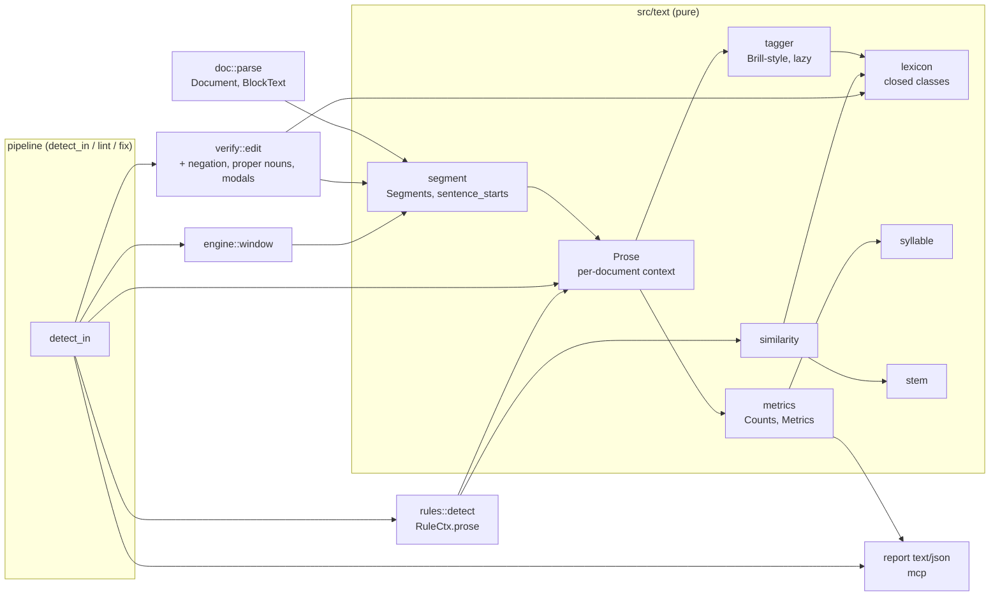
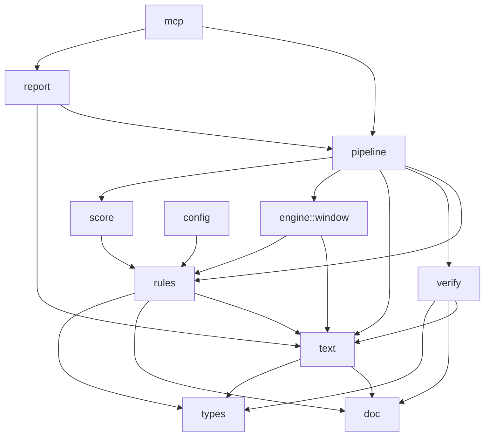
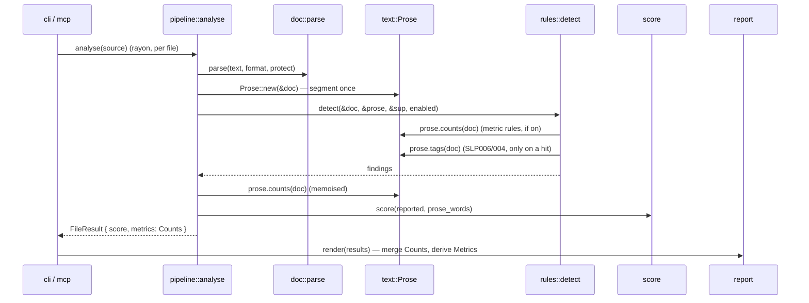
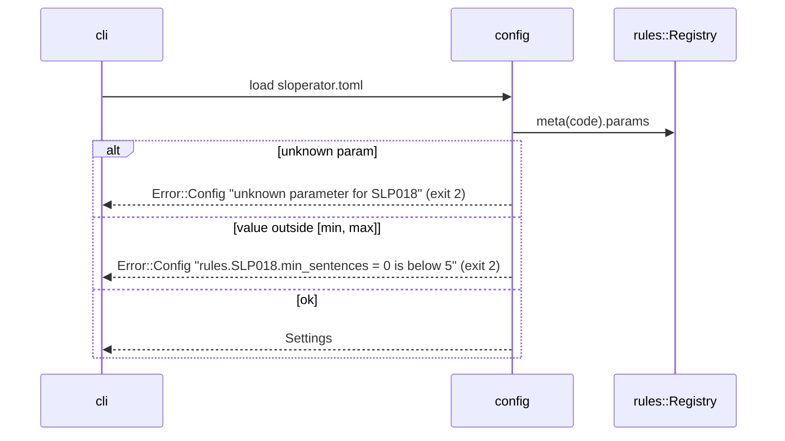

# Architecture: Classical (Non-Neural) NLP for Sloperator

**Version:** 0.1
**Date:** 2026-11-02
**Status:** Draft
**Companion:** [PRD](./PRD-classical-nlp.md) · no UX scope (CLI, JSON and MCP output only; surfaces are specified by PRD FR-3)
**Module(s):** new `src/text/` (segment, lexicon, syllable, metrics, tagger, stem, similarity); changed `src/doc/`, `src/rules/`, `src/engine/window.rs`, `src/verify/`, `src/pipeline/`, `src/report/`, `src/mcp/`, `src/config/`, `tests/`

---

## 1. Context and Quality Goals

This architecture adds one pure text-analysis layer (`src/text/`) under the rules, the verifier and the pipeline. It
segments each document once, computes reading metrics from integer counts, tags words lazily for gate-only use, and
compares sentences for redundancy. Metrics reach the reports as a sibling of the score and reach the score only
through ordinary default-off rules. The verifier gains three meaning invariants that apply to every edit origin. It
serves the [PRD](./PRD-classical-nlp.md); D-1 to D-11 are locked and referenced, not re-decided.

| Quality goal | From | What it demands of the design |
|--------------|------|-------------------------------|
| No output change at defaults | NFR-1, D-2, D-4 | New rules default-off; `Score` struct and formula untouched; the only always-on change is the additive `metrics` data in text/JSON/MCP and the verifier invariants, gated by a "no Safe fixture newly rejected" regression (FR-6.6) |
| One definition of a sentence | FR-1.4 | Window sentence ranges and metrics both call `text::segment`; the old private splitter in `engine/window.rs` is deleted (ADR-03) |
| Byte-identical output | NFR-3, D-6 | Metrics accumulate as `u64` counts and a sorted type set; floats appear only at `derive` time, rounded to 2 decimals (ADR-04) |
| 100 KB rules-only check < 1 s | NFR-2 | Segmentation is linear and done once per document pass; tagging is lazy and memoised per pass; similarity is pairwise only within a block (ADR-02) |
| Every edit verified | NFR-6, ADR-05 (product) | Templates and widened fixes are ordinary `Finding::fix` proposals; they go through the unchanged step-1 loop (`src/pipeline/mod.rs:113-122`) and the strengthened `verify::edit` |
| Pure, layered, thread-safe | NFR-7, NFR-8 | `src/text/` depends only on `crate::doc`, `crate::types` and std/`unicode-segmentation`; enforced by new rows in `tests/layering.rs`; per-document state in `OnceLock`, no globals beyond immutable `LazyLock` tables |
| Fail loudly | NFR-4 | Param bounds checked at config load (ADR-09); embedded data are compile-time Rust tables with unit tests (ADR-07); a rejected new invariant is SLP901, never a silent drop |

## 2. Existing System Touchpoints

| Touchpoint | Where (file:line) | What is true today | How this design uses or changes it |
|------------|-------------------|--------------------|------------------------------------|
| Score formula | `src/score/mod.rs:25-37`, `:39-48`, `:50-56` | `round2(1000 × Σ weight / max(words,1))`; `overall` sums raw counts | Unchanged (D-2). Metric and redundancy findings enter through it as Suggestion weight 1 (`:17-23`) |
| Pinned `Score` JSON | `tests/score.rs:96-98` | `{"value":32.52,"proseWords":123,"weighted":4}` | Unchanged; metrics are a sibling object, never a field of `Score` |
| Verification-limits sentence | `tests/score.rs:101-112`, `src/verify/mod.rs:4-5`, `docs/REFERENCE.md` | Says verification covers "not names or claim polarity" | Rewritten together in Phase 3 (FR-6.7) |
| Prose word count | `src/doc/mod.rs:234-241` | `unicode_words()` over every prose span | The segmenter counts words with the same function over the same spans (FR-1.3); metrics then filter to paragraph blocks (D-5) |
| Block text with `OBJ` | `src/doc/mod.rs:193-232` | Each non-prose run becomes one `OBJ`; `map` gives source offsets | Segmenter and tagger work on `BlockText`, so protected runs are never words (FR-1.2) |
| Block kinds | `src/doc/mod.rs:37-52` | `Paragraph`, `Heading`, `ListItem`, `TableCell` | Metrics use `Paragraph` only (D-5, FR-2.10) |
| Sentence splitter | `src/engine/window.rs:237-278` | Private `sentence_range`: blanks newlines and continuation prefixes, UAX #29 bounds, drops bounds inside protected runs | Its boundary logic moves to `text::segment::sentence_starts`; `sentence_range` keeps only the range arithmetic (ADR-03) |
| Continuation prefix | `src/engine/mask.rs:107-117` | `pub(crate) fn prefix_len(doc, ls, end)` lives in `engine` | Moves to `doc` as `Document::continuation_prefix_len`, because `text` may not depend on `engine` (ADR-03); `mask` calls the new method |
| Window selection | `src/engine/window.rs:110-119` | Model-class, or Safe with no fix, selects a window; `FixClass::None` never does | Unchanged. Metric, intensifier and redundancy rules are `FixClass::None` so they never select (FR-4.4); SLP003/004 become Safe so an unfixed match still selects (FR-8.3) |
| Window weight | `src/engine/window.rs:28-29` | `weight_before` = weighted findings overlapping the window | `Window` gains `codes: Vec<RuleCode>` (the non-system codes overlapping it), computed in the same pass, for the D-8 model exemption (ADR-06) |
| Rule context | `src/rules/mod.rs:83-98` | `RuleCtx { doc, params, severity }` | Gains `prose: &'a text::Prose` (ADR-02) |
| `detect` | `src/rules/mod.rs:155-177` | Each rule runs independently with a fresh `RuleCtx` | Builds no analysis itself; takes the caller's `&Prose`, shared by every rule (FR-7.3) |
| `ParamSpec` | `src/rules/mod.rs:60-66` | `name`, `default`, `help`; no bounds | Gains `min`, `max` (ADR-09); every existing spec gets explicit bounds |
| Config param validation | `src/config/mod.rs:483-523` | Unknown name rejected (`:509-511`); any number accepted (`:512-523`) | Adds a bounds check naming rule and param (NFR-4) |
| Rule-set version | `src/rules/mod.rs:145-146` | `"0.1.0"` | Bumped per phase that adds a rule (FR-11.1) |
| `Family` | `src/rules/mod.rs:46-58` | Nine kebab-case families | Gains `Readability`, `Wordiness`, `Redundancy` (additive) |
| `WordList` | `src/rules/helpers.rs:12-65` | Exact-phrase aho-corasick table, case-preserving replacement, `None` = no fix | Reused as is for the new SLP001 rows (explicit inflections, D-9) and for the intensifier rule's detection list |
| Sentence-start helper | `src/rules/helpers.rs:138-157` | `starts_sentence` on `BlockText` | Moves to `text::segment::starts_sentence`; `helpers` re-exports it so rule call sites keep compiling (no alias left behind: the old definition is deleted) |
| Lead-in fix | `src/rules/helpers.rs:159-175` | Deletes a lead-in and capitalises the next letter | Must keep passing the proper-noun check: that check ignores sentence-initial tokens (FR-6.2) |
| Document-level anchor | `src/rules/helpers.rs:197-211` | `first_prose` | Metric and redundancy rules report on a prose range found this way (FR-4.1) |
| SLP001 table | `src/rules/builtin/slp001_ai_vocabulary_replaceable.rs:1-27` | 17 rows, one per inflection | Gains the wordiness and nominalisation rows (FR-5.1; ADR-08) |
| SLP006 guards | `src/rules/builtin/slp006_copula_avoidance.rs:20-35`, `:113-128` | Fix only after 7 listed subjects; `MODALS` duplicated locally | Adds a tag-gated branch for other subjects (FR-7.5); `MODALS` moves to `text::lexicon` |
| SLP003 | `src/rules/builtin/slp003_not_x_but_y.rs:8-11`, `:26` | One regex, Model class | Class → Safe; template fix for the one-sentence `it's not X, it's Y` shape (FR-8.2) |
| SLP004 | `src/rules/builtin/slp004_not_just_but_also.rs:9-12`, `:27` | Two regexes, Model class | Class → Safe; template fix `X and Y` under tag guards (FR-8.1) |
| Proposal origin | `src/types.rs:49-62` | `ProposalOrigin::{Rule(code), Model}` | Read by verify for the rule-origin D-8 exemption |
| Per-edit verify | `src/verify/mod.rs:60-144` | Compares token multisets of the replaced bytes and the replacement, then reparses | Adds negation, proper-noun and modal multisets after the term check; signature gains `resolves: &[RuleCode]` (ADR-06) |
| `Check` enum | `src/verify/mod.rs:35-51` | Ten variants, serialised camelCase | Gains `Negation`, `ProperNouns`, `Modals` (FR-6.4) |
| Check names | `src/pipeline/mod.rs:331-342` | Exhaustive `match` | Three new arms; the compiler enforces completeness |
| Step 1 / step 2 | `src/pipeline/mod.rs:113-131`, `:262-292` | Safe fixes verified then applied; model windows verified, then improvement-checked | Unchanged flow; call sites pass `resolves` (`&[]` for step 1, `&w.codes` for step 2) |
| `detect_in` | `src/pipeline/mod.rs:294-309` | Parse, directives, detect | Builds one `Prose` per document pass and returns it with the findings |
| `FileResult` | `src/pipeline/mod.rs:52-63` | `score`, `score_before` | Gains `metrics: text::Counts` and `metrics_before: Option<text::Counts>` (ADR-05) |
| Parallel analysis | `src/cli/mod.rs:171` | rayon `par_iter` over sources | `Prose` is per document; `Send + Sync` asserted at compile time (NFR-8) |
| JSON report | `src/report/json.rs:13-14`, `:25-32`, `:88-96` | `schemaVersion: 1`; `File { path, score, scoreBefore, findings }`; `fix.available` from class | `File` gains `metrics`, `metricsBefore`; `Summary` gains `metrics`; no schema bump (D-11). SLP003/004 `available` becomes "a template fix was attached" (FR-8.4 consequence, Risks) |
| Text report | `src/report/text.rs:32`, `src/report/mod.rs:35-63` | One score line per file; `Summary::of` sums scores | A metrics line after the score line; `Summary::of` merges `Counts` |
| MCP results | `src/mcp/mod.rs:109-116`, `:207-220` | lint: `score`, `findings`; fix: `scoreBefore`, `scoreAfter` | lint adds `metrics`; fix adds `metricsBefore`, `metricsAfter` (FR-3.3) |
| Layering scans | `tests/layering.rs:9-95`, `:96-103` | Forbidden-use rows and `PURE_DIRS` | New row and `PURE_DIRS` entry for `src/text/` |
| Dependency gate | `deny.toml`, `Makefile:93-95`, `.github/workflows/ci.yml:32-35` | `cargo deny check` runs in `make check` and CI | Phase 6 stemmer decision runs through it (D-9) |
| Existing deps | `Cargo.toml` `[dependencies]` | `unicode-segmentation =1.13.3`, `aho-corasick =1.1.5`, `regex =1.13.1`, all exact pins | Reused; no new dependency before Phase 6 |

## 3. Overview



The shape is a pure analysis layer under the existing pipeline, in the same style the product already uses for
`doc`, `score` and `verify` (product ADR-01: single crate, layered modules). `text` is a library of pure functions
plus one per-document context value, `Prose`, that memoises the expensive, optional parts (tags, metric counts) with
`OnceLock`. Consumers are unchanged in kind: rules read `Prose` through `RuleCtx`; the pipeline reads metric counts
from `Prose` for reports; the verifier and the window code call the segmenter's boundary function directly. No new
runtime paths are added: every new fix is a `Finding::fix` and travels the existing step-1 loop to `verify::edit`.

## 4. Components

### 4.1 Segmenter (`text::segment`)

**Responsibility:** The crate's single definition of sentences and words over prose, with source ranges.
**Module / package root:** `src/text/segment.rs` / `crate::text::segment`
**Serves:** FR-1.1–FR-1.5, FR-2.10, NFR-7

```rust
/// Sentence start offsets within `block`'s source range, relative to its start: newlines and continuation
/// prefixes blanked, UAX #29 bounds, bounds strictly inside a protected run dropped. (Moved from window.rs:241-263.)
pub fn sentence_starts(doc: &Document, block: BlockId) -> Vec<usize>;

/// Whether `at` in a BlockText starts a sentence (moved from rules/helpers.rs:141).
pub fn starts_sentence(text: &str, at: usize) -> bool;

pub struct Sentence { pub block: BlockId, pub range: Range<usize>, pub words: Range<u32> /* into Segments::words */ }
pub struct Word { pub range: Range<usize> /* source bytes */, pub sentence_initial: bool }

/// Owned (no borrow of the Document), so it can sit beside the Document in pipeline structs.
pub struct Segments { pub sentences: Vec<Sentence>, pub words: Vec<Word> }

pub fn segment(doc: &Document) -> Segments;
```

Words are `unicode_words()` over the prose spans clipped to each sentence (the `prose_words` definition,
`src/doc/mod.rs:234-241`), so `segments.words.len() == doc.prose_words()` (FR-1.3).
**Depends on:** `crate::doc`, `unicode-segmentation` · **Must never depend on:** `rules`, `verify`, `engine`, `pipeline`, `report`, `config`, `input`, `write`, I/O

### 4.2 Closed-class lexicon (`text::lexicon`)

**Responsibility:** The closed word lists shared by the tagger, the verifier, SLP006 and redundancy (negations, modals, stop words, determiners, pronouns).
**Module / package root:** `src/text/lexicon.rs` / `crate::text::lexicon`
**Serves:** FR-6.1, FR-6.3, FR-7.1, FR-9.1

```rust
pub const NEGATIONS: &[&str];   // "not", "no", "never", "nor", "none", "nobody", "nothing", "nowhere", "neither"; SPEC closes the list
pub fn negation_count(word: &str) -> u32;  // "isn't", "don't", "can't", "won't" → 1 (n't forms, ASCII and ’)
pub const MODALS: &[&str];      // can could may might must shall should will would (FR-6.3); SLP006's local copy is deleted
pub const STOP_WORDS: &[&str];
```
**Depends on:** std · **Must never depend on:** anything else in the crate

### 4.3 Syllable counter (`text::syllable`)

**Responsibility:** A deterministic, approximate English syllable count per word.
**Module / package root:** `src/text/syllable.rs`
**Serves:** FR-2.3, FR-2.6, NFR-10

```rust
pub fn syllables(word: &str) -> u32; // vowel-group heuristic + silent-e/-le/-ed rules + a sorted exception table; min 1 for any word with a letter
```
**Depends on:** std · **Must never depend on:** anything else in the crate

### 4.4 Metrics (`text::metrics`)

**Responsibility:** Raw counts over paragraph blocks, their aggregation across files, and the derived, rounded metric values.
**Module / package root:** `src/text/metrics.rs`
**Serves:** FR-2.1–FR-2.10, D-5, D-6, NFR-3

```rust
/// Sufficient statistics (ADR-04). Merging is integer addition plus set union, so overall = merge of files.
#[derive(Clone, Debug, Default, PartialEq, Eq)]
pub struct Counts {
    pub words: u64, pub sentences: u64, pub syllables: u64,
    pub sentence_len_sq: u64,          // Σ (words in sentence)²  — gives population SD without a list
    pub types: BTreeSet<Box<str>>,      // case-folded distinct words; not serialised
}
impl Counts {
    pub fn merge(&mut self, other: &Counts);
    pub fn derive(&self) -> Metrics;   // applies MIN_SENTENCES / MIN_WORDS (D-5): below either, every value is None
}
pub const MIN_SENTENCES: u64 = 5;      // provisional (D-5)
pub const MIN_WORDS: u64 = 100;        // provisional (D-5)

#[derive(Clone, Copy, Debug, PartialEq, serde::Serialize)]
#[serde(rename_all = "camelCase")]
pub struct Metrics {
    pub words: u64, pub sentences: u64,
    pub avg_sentence_length: Option<f64>,       // FR-2.2
    pub grade_level: Option<f64>,               // FR-2.3, Flesch-Kincaid
    pub sentence_length_sd: Option<f64>,        // FR-2.4 population SD ("sentence-length variation", D-3)
    pub sentence_length_cv: Option<f64>,        // FR-2.4
    pub type_token_ratio: Option<f64>,          // FR-2.5
}
pub fn counts(doc: &Document, seg: &Segments) -> Counts; // Paragraph blocks only (D-5)
```
**Depends on:** `text::segment`, `text::syllable`, `crate::doc` · **Must never depend on:** `score`, `rules`, `report`, I/O

### 4.5 Tagger (`text::tagger`)

**Responsibility:** Assign each word one part-of-speech tag with an ambiguity/unknown flag, deterministically, for use as a fix gate only.
**Module / package root:** `src/text/tagger/{mod.rs, lexicon_data.rs, rules_data.rs}`
**Serves:** FR-7.1–FR-7.4, D-7, NFR-4

```rust
#[derive(Clone, Copy, Debug, PartialEq, Eq)]
pub enum Tag { Det, Pron, Noun, ProperNoun, Verb, VerbPast, VerbPart, Verb3s, Modal, Adj, Adv, Prep, Conj, Num, Other }
#[derive(Clone, Copy, Debug)]
pub struct Tagged { pub tag: Tag, pub certain: bool /* single lexicon tag, no contextual rule changed it, not unknown */ }

/// One tag per entry of `seg.words`, in order. Initial tags from the lexicon (sorted const table, binary search),
/// suffix heuristics for unknowns (certain = false), then the contextual rules in table order (ADR-07).
pub fn tag(doc: &Document, seg: &Segments) -> Vec<Tagged>;
```
**Depends on:** `text::segment`, `text::lexicon`, `crate::doc` · **Must never depend on:** any third-party tagger or lexicon (D-7), `rules`, I/O

### 4.6 Stemmer facade (`text::stem`) — Phase 6

**Responsibility:** One `stem` function whose backend is chosen in Phase 6 (D-9).
**Module / package root:** `src/text/stem.rs`
**Serves:** FR-9.1, D-9

```rust
pub fn stem(word_lower: &str) -> Cow<'_, str>; // rust-stemmers English (if cargo deny passes) or the in-tree suffix stripper
```
**Depends on:** std (+ `rust-stemmers` if chosen) · **Must never depend on:** anything else in the crate

### 4.7 Similarity (`text::similarity`) — Phase 6

**Responsibility:** Content-word overlap between sentences of one block.
**Module / package root:** `src/text/similarity.rs`
**Serves:** FR-9.1, FR-9.5

```rust
pub struct Bag(BTreeMap<Box<str>, u32>); // stemmed, stop words removed
pub fn bag(doc: &Document, seg: &Segments, s: &Sentence) -> Bag;
pub fn jaccard(a: &Bag, b: &Bag) -> f64;  // SPEC may choose cosine instead (FR-9.1 allows either); one is fixed
```
**Depends on:** `text::stem`, `text::lexicon`, `text::segment` · **Must never depend on:** `rules`, I/O

### 4.8 Per-document context (`text::Prose`)

**Responsibility:** Hold one document pass's segmentation and memoise its tags and metric counts.
**Module / package root:** `src/text/mod.rs` / `crate::text`
**Serves:** FR-7.3, FR-7.4, NFR-2, NFR-8

```rust
pub struct Prose {
    segments: Segments,                 // eager: metrics are always reported
    tags: OnceLock<Vec<Tagged>>,        // lazy (FR-7.4)
    counts: OnceLock<Counts>,
    #[cfg(test)] pub tag_runs: AtomicU32, // NFR-2 single-tagging test hook
}
impl Prose {
    pub fn new(doc: &Document) -> Prose;
    pub fn segments(&self) -> &Segments;
    pub fn tags(&self, doc: &Document) -> &[Tagged];
    pub fn counts(&self, doc: &Document) -> &Counts;
}
const _: fn() = || { fn ok<T: Send + Sync>() {} ok::<Prose>(); }; // NFR-8 compile-time assertion
```
`Prose` borrows nothing; it is always paired with the `Document` it was built from (the caller passes the same
`doc`). The SPEC may add a debug assertion on `doc.src.len()`.
**Depends on:** every `text` submodule · **Must never depend on:** anything outside `doc`/`types`/std

### 4.9 Rule integration (`rules`)

**Responsibility:** Give rules the shared context and host the new and changed rules.
**Module / package root:** `src/rules/` (`mod.rs`, `helpers.rs`, `builtin/*`)
**Serves:** FR-4.*, FR-5.*, FR-7.5–FR-7.8, FR-8.*, FR-9.*, FR-11.*

```rust
pub struct RuleCtx<'a> { pub doc: &'a Document, pub prose: &'a text::Prose, pub params: &'a BTreeMap<&'static str, f64>, pub severity: Severity }
pub fn detect(doc: &Document, prose: &text::Prose, sup: &Suppressions, rules: &[Enabled<'_>]) -> Vec<Finding>;
pub struct ParamSpec { pub name: &'static str, pub default: f64, pub min: f64, pub max: f64, pub help: &'static str }
```

New and changed rules (codes provisional, assigned in delivery order; the SPEC confirms):

| Code | Name | Class / default / severity | Reads | Phase |
|------|------|----------------------------|-------|-------|
| SLP018 | `grade-level` | None / off / Suggestion | `prose.counts` | 1 |
| SLP019 | `sentence-length-variation` | None / off / Suggestion | `prose.counts` | 1 |
| SLP020 | `long-sentences` (average length) | None / off / Suggestion | `prose.counts` | 1 |
| SLP021 | `lexical-diversity` | None / off / Suggestion | `prose.counts` | 1 |
| SLP001 | `ai-vocabulary-replaceable` + wordiness rows | Safe / unchanged default | `WordList` | 2 |
| SLP022 | `weak-intensifier` (detection only) | None / off / Suggestion | `WordList` | 2 |
| SLP006 | copula: tag-gated subjects | Safe / unchanged | `prose.tags` (lazy, only on a pattern hit) | 4 |
| SLP004 | template `X and Y` | Model → Safe | `prose.tags` | 5 |
| SLP003 | template `it's Y` | Model → Safe | `prose.segments` | 5 |
| SLP023 | `redundant-sentence` | None / off / Suggestion | `text::similarity` | 6 |

Metric rules' params: one threshold plus `minSentences`/`minWords`-style minimums whose `min` bound equals
`text::metrics::MIN_SENTENCES`/`MIN_WORDS`, so a rule can only raise the floor, never fire on a metric the report
shows as unavailable (FR-4.3). Param names follow the existing naming style (`max_per_1000_words`, `src/rules/mod.rs:60`).
**Depends on:** `doc`, `types`, `text`, `directives` · **Must never depend on:** `verify`, `engine`, `edit`, `write`, `report` (existing row, `tests/layering.rs:12-21`)

### 4.10 Verifier invariants (`verify`)

**Responsibility:** Reject any edit that reduces negations (beyond the D-8 allowance), removes or changes a non-sentence-initial capitalised token, or changes the modal multiset.
**Module / package root:** `src/verify/mod.rs`, new `src/verify/meaning.rs`
**Serves:** FR-6.1–FR-6.8, D-8, NFR-6

```rust
pub enum Check { /* existing … */ Negation, ProperNouns, Modals }

/// `resolves`: the non-system rule codes the edit is meant to resolve. Empty for safe fixes (the origin code is
/// read from `p.origin`); the window's codes for a model rewrite (ADR-06).
pub fn edit(doc: &Document, p: Proposal, frozen: &[Range<usize>], protect: &ProtectSettings,
            resolves: &[RuleCode]) -> Result<Verified<Proposal>, Rejection>;

// meaning.rs
pub(super) struct Meaning { negations: u32, proper: BTreeMap<String, u32>, modals: BTreeMap<String, u32> }
pub(super) fn meaning(text: &str, initial_at_start: bool) -> Meaning;
pub(super) fn negation_allowance(origin: ProposalOrigin, resolves: &[RuleCode]) -> u32; // SLP003/SLP004 count
```
Sentence-initial status of the edit's first token comes from `text::segment::sentence_starts` on the edit's block
(the one definition), and inside the replacement from `.`/`!`/`?` followed by whitespace. The checks run after the
term check (`src/verify/mod.rs:100-105`) and before the reparse, because they are cheaper.
**Depends on:** `doc`, `types`, `text::segment`, `text::lexicon` · **Must never depend on:** `rules`, `engine`, `write`, `report`

### 4.11 Pipeline and windows (`pipeline`, `engine::window`)

**Responsibility:** Build one `Prose` per document pass, carry metric counts into `FileResult`, and pass the D-8 context to verify.
**Module / package root:** `src/pipeline/mod.rs`, `src/engine/window.rs`
**Serves:** FR-1.4, FR-3.4, FR-6.4, FR-6.5, D-8, NFR-2

```rust
pub struct Analysis { pub source: Source, pub doc: Document, pub prose: text::Prose, pub sup: Suppressions, pub findings: Vec<Finding> }
pub struct FileResult { /* existing … */ pub metrics: text::Counts, pub metrics_before: Option<text::Counts> }
fn detect_in(text: Arc<str>, source: &Source) -> Result<(Document, text::Prose, Suppressions, Vec<Finding>), Error>;
// window.rs
pub struct Window { /* existing … */ pub codes: Vec<RuleCode> }
fn sentence_range(doc, block, r) -> Range<usize> // now calls text::segment::sentence_starts
```
**Depends on:** existing + `text` · **Must never depend on:** `cli`, `report`, `write`, `engine::runtime` (existing row)

### 4.12 Report and MCP surfaces (`report`, `mcp`)

**Responsibility:** Show metrics wherever the score is shown, unchanged score.
**Module / package root:** `src/report/{mod.rs,text.rs,json.rs}`, `src/mcp/mod.rs`
**Serves:** FR-3.1–FR-3.6

- Text: after `"{path}: score …"` (`src/report/text.rs:32`) a line `"{path}: metrics avg sentence 18.25 words, grade 11.40, sentence-length variation 6.10 (cv 0.33), type/token 0.52"`, or `"{path}: metrics unavailable (3 sentences, 64 words; needs 5 and 100)"`; in fix/diff a `metrics before` line too; the summary line gains the overall metrics.
- JSON: `File.metrics: Metrics`, `File.metricsBefore: Option<Metrics>`, `summary.metrics: Metrics`; unavailable values are `null`.
- MCP: lint `metrics`; fix `metricsBefore`, `metricsAfter`.
- `concise`, `github`: unchanged (FR-3.5).

**Depends on:** `pipeline::FileResult`, `text::metrics` · **Must never depend on:** `engine`, `write`, `config::Resolver` (existing row)

### 4.13 Config bounds (`config`)

**Responsibility:** Reject out-of-range rule params at load, naming rule and param.
**Module / package root:** `src/config/mod.rs:483-523`
**Serves:** NFR-4
**Depends on:** `rules::ParamSpec` · **Must never depend on:** `pipeline`, `engine`, `report`, `write` (existing row)

### 4.14 Model-reliance harness (`tests/model_reliance.rs`, `eval/model-reliance.md`)

**Responsibility:** Measure Model-class plus fix-less Safe findings per 1,000 prose words left by a rules-only fix over `eval/paragraphs`, and fail if it rises above the recorded baseline.
**Serves:** FR-10.1–FR-10.3
The selection predicate is the one in `src/engine/window.rs:110-119`; the SPEC exposes it as `pub(crate) fn selects` or reimplements it from `Registry` metadata in the test (no new public API needed). Values are recorded per phase in `eval/model-reliance.md`; the test parses the baseline line.
**Depends on:** public `pipeline` API · **Must never depend on:** a model or the network

## 5. Module Dependencies



| Rule | Enforced by |
|------|-------------|
| `src/text/` uses no crate module except `crate::doc` and `crate::types` | New `FORBIDDEN_USES` row in `tests/layering.rs` listing `crate::rules`, `crate::verify`, `crate::engine`, `crate::pipeline`, `crate::report`, `crate::config`, `crate::input`, `crate::write`, `crate::edit`, `crate::score`, `crate::directives`, `crate::model`, `crate::mcp`, `crate::cli` |
| `src/text/` does no I/O | `"src/text/"` added to `PURE_DIRS` (`tests/layering.rs:96-103`), scanned for `std::fs`, `std::net`, `std::process`, `std::env` |
| `src/doc/` still uses no crate module (incl. after `continuation_prefix_len` moves in) | Existing row `("src/doc/", &["crate::"])`, `tests/layering.rs:10` |
| `src/rules/` never uses `verify` | Existing row, `tests/layering.rs:12-21` |
| `src/verify/` never uses `rules` (so the D-8 exemption list is `RuleCode` constants in verify, not a registry lookup) | New entry `crate::rules` added to the `src/verify/` row (`tests/layering.rs:40-43`); the import of `crate::types::RuleCode` stays legal |
| No third-party tagger crate or lexicon | `deny.toml` unchanged until Phase 6; review of `Cargo.toml` diff; D-7 |
| Every `Check` has a name | Exhaustive `match` in `check_name` (`src/pipeline/mod.rs:331-342`) — a missing arm fails `cargo build` |
| `Prose` is `Send + Sync` | Compile-time assertion in `src/text/mod.rs` |

## 6. Data and State

- **`Segments`** — owned by `Prose`; built eagerly by `Prose::new` in `detect_in`; lives for one document pass; never persisted.
- **Tags** — `OnceLock<Vec<Tagged>>` inside `Prose`; filled on the first `prose.tags(doc)` call (SLP006 only after a pattern hit, SLP004 only after a match); never filled for a document with no hit (FR-7.4).
- **`Counts`** — `OnceLock<Counts>` inside `Prose`; filled by the first metric rule or by the pipeline when it builds `FileResult`. Moved (cloned once) into `FileResult.metrics`; `metrics_before` comes from the original analysis's `Prose` (fix/diff only). `Summary::of` merges file counts in the `results` order it already uses (`src/report/mod.rs:48-63`), which `ordered` sorts by path, so the merge order is fixed.
- **`Metrics`** — derived at render time from `Counts`; the only place floats exist; rounded with the same `round2` rule as the score (`src/score/mod.rs:54-56`; a shared private helper in `text::metrics`, not an import of `score`).
- **Embedded data** — lexicon, contextual rules, syllable exceptions, stop words, negations, modals, the SLP001 rows and the intensifier list: all `const`/`static` Rust tables compiled into the binary (ADR-07). No files are read at runtime.
- **JSON shape** — additive keys only; `schemaVersion` stays 1 (D-11). Old readers that ignore unknown keys are unaffected.
- **`eval/model-reliance.md`** — a checked-in Markdown table: phase, residual per 1,000 words, date. Written by hand from the test's printed value; the test reads the baseline row.

## 7. Runtime Views

### 7.1 Lint (main request path)



Failures: a bad directive is `Error::Directive` as today; nothing in `text` returns an error (pure, total
functions over a parsed document). A metric below the minimums is `None` in `Metrics`, rendered `null`/"unavailable".

### 7.2 Fix: safe fixes and model windows

```mermaid
sequenceDiagram
  participant P as pipeline::fix
  participant V as verify::edit
  participant T as text (segment, lexicon)
  participant W as engine::window
  participant M as model
  P->>V: edit(doc0, fix, frozen, protect, resolves=[])
  V->>T: sentence_starts(block) for proper-noun initial check
  V->>V: numbers, urls, terms, negation (allowance from origin SLP003/004), proper nouns, modals, reparse
  alt rejected
    V-->>P: Rejection(Check::Negation | ProperNouns | Modals | …) → SLP901
  else verified
    V-->>P: Verified
  end
  P->>P: apply; detect_in(text1) → new Prose (one pass)
  P->>W: windows(doc1, findings1) — Window.codes, sentence ranges via text::segment
  W-->>P: plans
  P->>M: rewrite(window)
  M-->>P: raw
  P->>V: edit(doc1, proposal, frozen, protect, resolves=&w.codes)
  V-->>P: Verified / Rejection → SLP901
  P->>P: improvement check (detect_in on candidate: one Prose per candidate pass)
  P->>P: verify::document; metrics_before = doc0 prose.counts; metrics = final prose.counts
```

Failure paths: every new invariant failure is a `Rejection` with its own `Check`, turned into SLP901 by
`rejection()` (`src/pipeline/mod.rs:320-329`) with the check name in the message (FR-6.4, FR-6.5); the original bytes
stay. A model load error is still `Error` and exits 2. The whole-document check discards all edits as today
(`src/pipeline/mod.rs:173-180`), and then `metrics` equals `metrics_before`.

### 7.3 Startup and configuration failure



Embedded tables cannot fail at startup: they are compile-time constants (ADR-07). Their invariants (sorted, unique,
non-empty, every tag valid) are unit tests that run in CI, so a broken table fails the build gate, never a run.

## 8. Cross-cutting Concerns

- **Threading:** Analysis runs on rayon workers, one file per task (`src/cli/mod.rs:171`); each `Prose` is created and used by one worker and dropped with its `Analysis`. `OnceLock` makes the lazy fields safe if a future caller shares a `Prose`. Global state is limited to immutable `LazyLock` automata/tables, as in `src/verify/tokens.rs:15-23`. The model path stays serial (product ADR-09).
- **Errors:** `text` functions are total and return no `Result`; malformed input yields fewer sentences, never a panic (the SPEC adds a property test over random UTF-8). Config bounds violations are `Error::Config` at load. Verifier invariant failures are `Rejection` → SLP901, never dropped. A metric that cannot be computed is reported as unavailable, not as 0 (FR-2.7). No `unwrap` on input-derived values (clippy `-D warnings` gate, `Makefile:93`).
- **Configuration:** New keys are rule params under `[rules.SLPxxx]`, validated by name (existing) and by `[min, max]` (new). Param names follow the existing snake_case param convention (`max_per_1000_words`); this keeps the config file consistent with the one shipped style, and is noted because the team default is camelCase (see Risks). No new top-level config table: report minimums are constants (D-5 provisional values).
- **Persistence and formats:** JSON gains `metrics`, `metricsBefore` (file) and `metrics` (summary), additive, `schemaVersion` 1 (D-11). `Check` gains three camelCase variants (`negation`, `properNouns`, `modals`) — it is serialised but only through SLP901 messages today. `FixClass` of SLP003/004 changes in `explain`, the rule catalogue and JSON `fix.class`; every call site and doc updated together, no alias (NFR-9).
- **Security:** No new trust boundary. No network, no file reads (NFR-5); the existing no-network test pattern is rerun on a metrics-enabled lint and fix.
- **Observability:** No new logs. The `#[cfg(test)]` tag-run counter backs the NFR-2 single-tagging test. Verifier rejections name the failed invariant in SLP901 messages.
- **Performance budgets:** 100 KB rules-only < 1 s with every new rule on (NFR-2) → linear segmentation once per pass; lexicon lookups by binary search on a sorted table; tags lazy; similarity pairwise only within one block (paragraph sentence counts are small); `tests/perf.rs:87` enables SLP018–SLP023 and SLP006 widening. Model path: one `Prose` per candidate pass, never per rule.

## 9. Tech Stack

| Category | Technology | Version | Why | Rejected alternative |
|----------|------------|---------|-----|----------------------|
| Segmentation | `unicode-segmentation` (existing) | `=1.13.3` (pinned in `Cargo.toml`) | Already used by `prose_words` and the window splitter; one sentence/word definition | `srx`/rule-based splitter crates: new dependency, a second definition |
| Phrase matching | `aho-corasick` (existing) | `=1.1.5` | `WordList` already wraps it | Regex alternation per row: slower, no leftmost-longest |
| POS tagging | In-tree Brill-style tagger, const tables | n/a | D-7 (locked) | `nlprule`, other Rust tagger crates: rejected by D-7 (young, unread licences and lexicons) |
| Syllables | In-tree heuristic + exception table | n/a | FR-2.6; deterministic and small | CMUdict (~3.5 MB, licence and coverage work for an approximate metric) |
| Stemming (Phase 6) | `rust-stemmers` (Snowball English) **or** in-tree suffix stripper | `=1.2.0` if chosen (last release 2019-11-17 per research; exact pin) | D-9 (locked): chosen by `cargo deny` at Phase 6 | Porter in-tree reimplementation of full Snowball: more code than the redundancy rule needs |
| Platform | Rust edition/toolchain unchanged | — | No new platform requirement | — |

Added footprint: tables of a few hundred KB at most plus, optionally, `rust-stemmers` (~2.3 MB source, per research);
far under the NFR-5 50 MB cap and the 1 GB limit. A release-binary size check before and after is recorded in Phase 1
and Phase 6.

## 10. Source Tree

```
src/
  text/
    mod.rs            Prose, re-exports, Send+Sync assertion
    segment.rs        sentence_starts, starts_sentence, Segments (moved logic from engine/window.rs, rules/helpers.rs)
    lexicon.rs        NEGATIONS, MODALS, STOP_WORDS, determiners, pronouns
    syllable.rs       syllables() + exception table
    metrics.rs        Counts, Metrics, MIN_SENTENCES, MIN_WORDS, round2
    tagger/
      mod.rs          Tag, Tagged, tag()
      lexicon_data.rs sorted const word→tags table
      rules_data.rs   ordered contextual rules
    stem.rs           Phase 6
    similarity.rs     Phase 6
  doc/mod.rs          + Document::continuation_prefix_len (moved from engine/mask.rs:107-117)
  verify/meaning.rs   negation, proper-noun, modal multisets
  rules/builtin/
    slp018_grade_level.rs, slp019_sentence_length_variation.rs, slp020_long_sentences.rs,
    slp021_lexical_diversity.rs, slp022_weak_intensifier.rs, slp023_redundant_sentence.rs
tests/
  text_segment.rs, text_metrics.rs, text_tagger.rs, model_reliance.rs (new)
  fixtures/rules/SLP018…SLP023/ (positive, negative); SLP003/SLP004 gain fixed.md
eval/model-reliance.md
```

`lib.rs` gains `pub mod text;`. Nothing else moves between modules except the two helpers named above.

## 11. Test Architecture

| Tier | Proves | Runs as | In CI |
|------|--------|---------|-------|
| Unit (in `src/text/*`) | Formulas against hand-computed values; syllables on a fixed list; table invariants (sorted, unique, non-empty, valid tags); tagger known/unknown/ambiguous | `make -f "$AEGIS_DIR/Makefile" test UNIT=sloperator TESTS='text::'` | yes |
| Integration: segmentation | FR-1.2 (no split in protected spans), FR-1.3 (word count = `prose_words` over every fixture in `tests/fixtures`), FR-1.4 (window sentence ranges unchanged on existing window tests) | `… TESTS='text_segment window'` | yes |
| Integration: metrics and reports | FR-2.*, FR-3.*: JSON `metrics`/`metricsBefore`/`summary.metrics`, text line, MCP fields, `null` when unavailable; repeated-run byte equality (NFR-3) | `… TESTS='text_metrics report mcp score'` | yes |
| Rule fixtures | FR-4.7, FR-5.2, FR-5.5, FR-7.7, FR-7.8, FR-8.7, FR-9: positive/negative per new rule, `fixed.md` and idempotency, grammatical contexts | `… TESTS='rules_fixtures'` (`every_rule_has_fixtures`; `safe_fix_contexts_grammatical`, `tests/rules_fixtures.rs:304`; `fix_is_idempotent_over_all_fixtures`, `:526`) | yes |
| Verifier | FR-6.8: one rejection and one acceptance per new `Check`; D-8 allowance for rule and model origins; FR-6.6 regression: every Safe fixture's fixes still verify | `… TESTS='verify_edits pipeline'` | yes |
| Pipeline | NFR-6: a failing new-rule fix becomes SLP901 (`tests/pipeline.rs:117` pattern); NFR-2 single tagging per pass across a multi-window fix with a fake rewriter (`DisabledFactory`-style port, `src/engine/mod.rs:44`) | `… TESTS='pipeline'` | yes |
| Config | NFR-4: unknown and out-of-range params rejected with rule and param named | `… TESTS='config'` | yes |
| Layering | NFR-7: new rows | `… TESTS='layering'` | yes |
| Performance | NFR-2: 100 KB < 1 s with all new rules on (`tests/perf.rs:87`) | `… TESTS='perf'` | yes |
| Model reliance | FR-10: residual ≤ baseline | `… TESTS='model_reliance'` | yes |
| No network | NFR-5 over a metrics-enabled lint and fix | existing no-network test, extended | yes |

Seams that keep it headless: `text` is pure over `Document`; the model port (`engine::Rewriter`) already has fakes
for pipeline tests; `Prose`'s `#[cfg(test)]` counter observes tagging without mocks.

## 12. Delivery Architecture

| Phase | Delivers | Proves | Gate before the next phase (pass/fail) |
|-------|----------|--------|----------------------------------------|
| 1a | `tests/model_reliance.rs` + baseline row in `eval/model-reliance.md`, before any rule change | FR-10.2 baseline exists | Test passes and the baseline row is committed |
| 1b | `text::segment`, `continuation_prefix_len` move, window uses it; layering rows | One sentence definition; no behaviour change | All existing `window`/`mask` tests pass unmodified; FR-1.3 equality holds on every fixture (fails if any prose span lies outside a block — see Risks) |
| 1c | `syllable`, `metrics`, `Prose`; `FileResult`, text/JSON/MCP surfaces; pinned report JSON updated | Brad's priority shipped | NFR-3 repeated-run test byte-identical; report/mcp tests updated only for the added keys; release binary size recorded |
| 1d | SLP018–SLP021 default-off, `ParamSpec` bounds, `RULE_SET_VERSION`, CHANGELOG, REFERENCE | Metrics feed the score via rules | Fixtures pass; config bound tests pass; with defaults, scores in all existing tests unchanged |
| 1e | Calibration corpus (licence-clean human prose, a few MB) and recorded values | D-4 follow-up | Corpus licence recorded; values written beside thresholds; no default changed in this phase |
| 2 | SLP001 wordiness rows; SLP022 detection-only | More no-model fixes | `fixed.md` grammatical, idempotent; FR-10 value recorded and ≤ baseline |
| 3 | Negation, proper-noun, modal checks; `resolves`; `Window.codes`; doc sentence updated in 3 places | Meaning invariants | **FR-6.6 gate:** zero Safe fixture fixes newly rejected (fail = any). Rejection/acceptance test per check |
| 4 | Tagger + SLP006 widening | Tag-gated Safe fixes | **Spike gate (start of phase):** the tagger marks ≥ 1 new subject class certain on the SLP006 positive set and declines on every negative fixture; if it cannot, SLP006 widening is dropped and the phase ships the tagger only for Phase 5. Perf and single-tagging tests pass |
| 5 | SLP004 and SLP003 templates; class → Safe | Two Model-only tells fixed without a model | Templates pass verify only through the D-8 allowance; SLP007/015 diff empty; FR-10 value ≤ baseline |
| 6 | Stemmer decision, similarity, SLP023 | Redundancy detection | `cargo deny check` result recorded; perf test passes with SLP023 on; FR-10.3 final value ≤ baseline |

Sequencing: phases 3 and 4 both touch `src/pipeline/mod.rs` call sites only lightly; 4 and 5 both add `prose.tags`
consumers, so 5 follows 4. No other live initiative touches `src/text/`; anything editing `verify::edit`'s signature
or `RuleCtx` in parallel must rebase on Phase 1b/3. Rollout: each phase is independently releasable; new rules
default-off. Rollback: revert the phase's commits; there is no persisted state or migration, and the JSON change is
additive.

## 13. Decisions

| ADR | Decision | Status |
|-----|----------|--------|
| [ADR-01](./adr/ADR-01-text-analysis-layer.md) | One new pure `src/text/` module (not several top-level modules, not inside `doc` or `rules`) | Accepted |
| [ADR-02](./adr/ADR-02-per-document-prose-context.md) | A per-document `Prose` value with eager segments and `OnceLock` tags/counts, passed through `RuleCtx` | Accepted |
| [ADR-03](./adr/ADR-03-single-sentence-definition.md) | Sentence boundaries move from `engine::window` to `text::segment`; `prefix_len` moves to `doc` | Accepted |
| [ADR-04](./adr/ADR-04-metric-counts-sufficient-statistics.md) | Metrics carry sufficient statistics (Σlen²) and a type set; overall = merge, not sum of per-file types | Accepted |
| [ADR-05](./adr/ADR-05-metrics-report-surface.md) | `metrics`/`metricsBefore` siblings of `score`/`scoreBefore`; MCP `metricsBefore`/`metricsAfter`; no schema bump | Accepted |
| [ADR-06](./adr/ADR-06-verifier-meaning-invariants.md) | Invariants inside `verify::edit`; D-8 as a counted allowance from origin or `resolves` | Accepted |
| [ADR-07](./adr/ADR-07-embedded-data-as-const-tables.md) | Lexicon, rules, syllable and word tables as compile-time Rust tables | Accepted |
| [ADR-08](./adr/ADR-08-wordiness-rows-and-intensifier-rule.md) | Wordiness rows extend SLP001; intensifiers go to a new `FixClass::None` rule | Proposed — needs Brad |
| [ADR-09](./adr/ADR-09-param-bounds.md) | `ParamSpec` gains `min`/`max`, checked at config load | Accepted |

Locked PRD decisions this design relies on: D-1 (phase order), D-2 (score via rules), D-3 (naming), D-4 (default-off,
Suggestion, fix-less), D-5 (paragraphs, minimums), D-6 (raw counts), D-7 (in-tree tagger, gate only), D-8 (negation
exemption), D-9 (deps), D-10 (Safe = truth-conditionally neutral), D-11 (defaults, no schema bump).

## 14. Risks

| Risk | Likelihood / impact | Mitigation | Owner phase |
|------|---------------------|------------|-------------|
| FR-1.3 fails because some prose span has `block: None` (bytes between blocks counted by `prose_words`, `src/doc/mod.rs:234-241`, but in no block) | M / M | Phase 1b gate test over all fixtures; if it fails, `Segments` counts block-less prose spans as words in no sentence (still equal), and the SPEC records it | 1b |
| Proper-noun check rejects existing Safe fixes (acronyms, title case inside SLP001 rows, `match_case` all-caps output, `src/rules/helpers.rs:79-92`) | M / M | Multiset compare (not position), sentence-initial exclusion, FR-6.6 gate; failures are loud SLP901 | 3 |
| D-8 model allowance lets a model drop a negation unrelated to the SLP003/004 match in the same window | L / M | Allowance is a count (one per SLP003/004 finding in the window), not a switch; the window must also show strict improvement (`src/verify/mod.rs:146-158`) | 3 |
| SLP003/004 class change alters JSON `fix.available` for unfixed matches from `true` to `false` (`src/report/json.rs:88-96`), although the model can still fix them | H / L | Documented in REFERENCE and CHANGELOG; flagged to Brad under "For the adversarial review". Alternative (a "model-fallback" availability) is a public-surface change outside the PRD | 5 |
| Metric findings anchored on the first paragraph take part in a window's improvement check (`src/pipeline/mod.rs:283-291`), so a rewrite can be accepted because it moved a document metric | L / L | Default-off; SPEC adds a pipeline test; if it misbehaves, anchor document-level findings on a zero-width range at the first prose byte, which no window overlaps | 1d |
| TTR length dependence (PRD Risk 3) | H / L | Reported as is (FR-2.5 locked); REFERENCE documents it; rule default-off; calibration across lengths | 1e |
| Tag errors produce wrong Safe fixes | M / H | Gate-only, `certain` requires a single lexicon tag and no rule change; negative fixtures per class; Phase 4 spike gate | 4 |
| Param naming: existing params are snake_case while team convention says camelCase | L / L | Follow the shipped style for consistency; flagged for Brad; a rename of existing params would be a breaking config change outside the PRD | 1d |
| `rust-stemmers` unmaintained since 2019 | M / L | D-9 path: exact pin + `cargo deny`, else in-tree stripper behind the `stem` facade | 6 |
| Overall TTR needs the union of type sets, so `FileResult` holds a `BTreeSet` per file (memory ~ distinct words) | L / L | Bounded by vocabulary; MCP and single-file runs hold one | 1c |

## PRD Deviation Notes

1. **D-6 "summed distinct types" cannot be literally true.** Distinct types are not additive across files (a word in
   two files would count twice). The design keeps D-6's intent (overall derives from raw data, never a mean of
   per-file values) by merging the case-folded type sets (ADR-04). FR-2.1's "list of per-sentence word lengths" is
   replaced by the equivalent sufficient statistics (count, Σlen, Σlen²), which give the exact population SD
   (FR-2.4) and sum across files.
2. **The PRD's "existing wordiness rule" does not exist.** No rule is named wordiness; the Safe phrase table is SLP001
   `ai-vocabulary-replaceable` (`src/rules/builtin/slp001_ai_vocabulary_replaceable.rs:1-27`), which PRD root cause 3
   cites. ADR-08 puts the wordiness rows in SLP001 and the detection-only intensifiers in a new default-off rule,
   because a `None`-replacement row in a Safe rule selects a model window (`src/engine/window.rs:116`), which would
   send intensifiers to the model and raise model reliance against FR-10.3 and D-10. This needs Brad's confirmation.
3. **Report minimums are constants, rule minimums are params.** D-5 says the minimums are "configurable as params";
   params belong to rules, and metrics are reported with every rule off. The report uses the D-5 constants; each
   metric rule's minimum params are bounded below by them (ADR-09), so FR-4.3 holds.
4. **`starts_sentence` and `prefix_len` move modules** (ADR-03) — interpretation of FR-1.4, no behaviour change.

## Self-Audit

| Requirement / UX surface | Component(s) |
|--------------------------|--------------|
| FR-1.1, FR-1.2, FR-1.3, FR-1.5 | §4.1 Segmenter |
| FR-1.4 | §4.1 Segmenter, §4.11 windows (ADR-03) |
| FR-2.1–FR-2.5, FR-2.7–FR-2.10 | §4.4 Metrics (ADR-04) |
| FR-2.6 | §4.3 Syllable counter |
| FR-3.1–FR-3.6 | §4.12 Report and MCP, §4.11 pipeline (ADR-05) |
| FR-4.1–FR-4.7 | §4.9 rules SLP018–SLP021, §4.13 config, §4.4 metrics |
| FR-5.1–FR-5.3, FR-5.5 | §4.9 SLP001 (ADR-08) |
| FR-5.4 | §4.9 SLP022 (ADR-08) |
| FR-6.1–FR-6.8 | §4.10 Verifier, §4.2 lexicon, §4.11 pipeline/windows (ADR-06) |
| FR-7.1–FR-7.4 | §4.5 Tagger, §4.8 Prose (ADR-02, ADR-07) |
| FR-7.5–FR-7.8 | §4.9 SLP006 |
| FR-8.1–FR-8.7 | §4.9 SLP003/SLP004, §4.10 D-8 allowance |
| FR-9.1–FR-9.6 | §4.6 stem, §4.7 similarity, §4.9 SLP023 |
| FR-10.1–FR-10.3 | §4.14 Model-reliance harness |
| FR-11.1–FR-11.3 | §4.9 rules, §12 phases (REFERENCE, CHANGELOG, catalogue) |
| NFR-1 | §1 goals, §12 gates (defaults unchanged, FR-6.6) |
| NFR-2 | §4.8 Prose, §8 performance, §11 perf + single-tagging tests |
| NFR-3 | §4.4 Counts, §6, §11 repeated-run test |
| NFR-4 | §4.13 config bounds (ADR-09), ADR-07 table tests |
| NFR-5 | §8 security, §9 footprint, §11 no-network test |
| NFR-6 | §4.10, §7.2 (no new apply path) |
| NFR-7 | §5 module rules and layering rows |
| NFR-8 | §4.8 Send+Sync assertion, §8 threading |
| NFR-9 | §8 persistence (no aliases; SLP003/004 class, `Check` set, doc sentence updated everywhere) |
| NFR-10 | §11 test tiers |
| UX | no UX scope |

**For the adversarial review:** (1) ADR-08 — whether wordiness rows belong in SLP001 (default-on, AI-vocabulary
family) or in a new default-off rule; this changes what default users get and needs Brad. (2) ADR-06 — the D-8 model
allowance as a count of SLP003/004 findings in the window, and passing `resolves` into `verify::edit`. (3) The
SLP003/004 JSON `fix.available` change. (4) ADR-04's deviation from the literal D-6/FR-2.1 wording.
